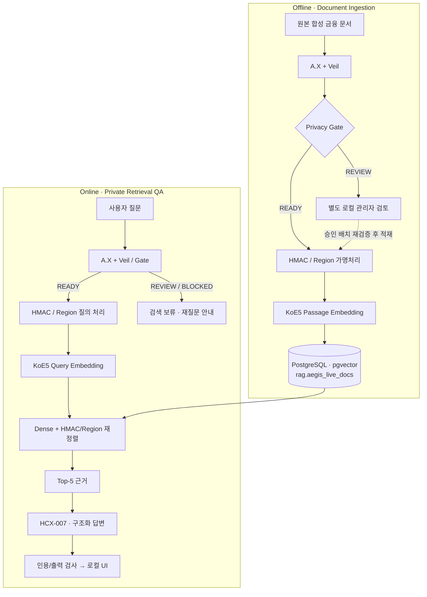

# AegisRAG

> **Privacy-Preserving RAG for Korean Financial Documents**
>
> 개인정보를 감추면서도 같은 개체를 검색할 수 있도록, **실제 PII 탐지 → 안전성 검증 → HMAC 가명처리 → 근거 검색 → 인용 기반 답변**을 연결한 로컬 RAG 프로젝트입니다.

**현재 상태:** 실전 1 문서 187건 적재 및 실전 2 검색 평가 완료 · 질의 88건 중 85건 자동 처리 · 실제 HCX 응답·인용의 온라인 E2E 검증은 진행 중

## Key Features

| 영역 | 구현 |
| --- | --- |
| **PII Detection** | A.X + Veil 이중 모델, Privacy Gate, 보류(REVIEW)/차단(BLOCKED) |
| **Pseudonymization** | 라벨별 정규화 + HMAC-SHA256 96-bit 토큰, 주소 Region Key |
| **Retrieval** | KoE5 (1024-dim) + PostgreSQL/pgvector, HMAC·지역 우선 순위 + 안전한 문서 유형 어휘 보정 |
| **Answer Generation** | HyperCLOVA X HCX-007, Structured Outputs, 근거 문서 ID 인용 검증 |
| **Operations** | 187건 단일 Live Index, 승인된 신규 문서만 증분 적재, 로컬 웹 UI |
| **Evaluation** | Hit@K, Recall@K, MRR, Confusable@K, 유형별 실패 분석, CPU p50/p95 |

## Architecture



- 원문/Gold를 GitHub에 포함하지 않습니다. 문서 임베딩은 적재 시 한 번 계산하고, 온라인에서는 **질의만** 임베딩합니다.
- 보류된 질의를 강제로 가명처리하거나 LLM에 보내지 않습니다. 로컬 관리자 REVIEW 도구는 별도 관리하며 이 저장소의 공개 기능으로 주장하지 않습니다.
- 현재 검색은 **Dense + 결정적 토큰/지역 일치 기반 순위 보정**입니다. BM25나 Cross-Encoder를 적용한 실험 결과는 아직 없습니다.

## Evaluation

**동결 V6 기준선 (2026-11-12 · 합성 Holdout 187문서/88질의 · macOS CPU)**

> 아래 수치는 **문서 유형 어휘 보정 및 안전한 단일 인물 질의 복구 기능 추가 이전** 결과입니다. 최신 MVP의 실측 점수는 `AEGISRAG_TOPIC_BOOST=1`, `AEGISRAG_QUERY_RECOVERY=1` 조건에서 **다시 측정해야 합니다**.

| 지표 | 결과 |
| --- | ---: |
| 문서 처리·인덱싱 | **187 / 187** (자동 처리 177 + 검토 후 적재 10) |
| 온라인 질의 상태 | **READY 85 · REVIEW 2 · BLOCKED 1** |
| 전체 질의 Hit@1 / Hit@5 | **77/88 (87.50%) / 83/88 (94.32%)** |
| 전체 질의 MRR | **0.9051** |
| 검색 가능 85질의 Hit@1 / Hit@5 | **90.59% / 97.65%** |
| 검색 가능 85질의 Recall@5 / MRR | **0.8848 / 0.9371** |
| 검색 가능 85질의 Confusable@5 | **27/85 (31.76%, 낮을수록 좋음)** |
| 로컬 CPU 검색 p50 / p95 | **717ms / 1,637ms** (모델 워밍업 후, HCX 제외) |

**평가 범위:** 88질의 전체 성능은 REVIEW/BLOCKED 3건을 실패로 계산합니다. Recall@5와 Confusable@5는 검색 가능한 85질의 기준이며, 기존 Hit/MRR은 Gold의 neutral 문서를 *채점할 때만* 제외합니다. 전체 답변 정확도·새로운 비공개 데이터 일반화·PII 누락 제로를 증명하는 수치는 아닙니다.

**현재 오류 분석:** Q001/Q015/Q033 질의 보류 · Q055/Q065 정답 Top-5 미포함 · 동일 이름 및 혼동 근거 노출 개선 필요. 상세 결과와 개선 이력은 [실험 로그](docs/IMPROVEMENT_LOG.md)에 분리합니다.

## Tech Stack

`Python 3.11` · `PyTorch` · `ONNX Runtime` · `Transformers` · `KoE5` · `PostgreSQL 16` · `pgvector` · `Docker` · `HCX-007` · `HTML/CSS/JavaScript`

## Quick Start

> 실제 모델은 [PII-detect Hugging Face 조직](https://huggingface.co/PII-detect)의 Private 저장소입니다. 적절한 읽기 권한의 `HF_TOKEN`, 로컬 `.env`, PostgreSQL 환경과 **별도로 제공된 합성 평가 파일/인덱스**가 필요합니다. 새 clone만으로 187문서가 자동 적재되지는 않습니다.

```bash
git clone https://github.com/kohjunseo1/AegisRAG.git
cd AegisRAG
# PR #7을 병합하기 전에는 해당 feature 브랜치 사용:
git checkout fix/v6-chat-index-hcx-hf-org-20261112

python3.11 -m venv .venv
source .venv/bin/activate
pip install -r requirements.lock -e ./step1_pii_detector

test -f .env || cp .env.example .env
chmod 600 .env
# .env에 HF_TOKEN, 기존 HMAC 키, DB 및 LLM 연결값 설정
docker compose --env-file .env -f step2_privacy_rag/compose.yaml up -d db
python scripts/aegisrag.py models --device cpu
python scripts/verify_v6_e2e.py
```

**187문서 Live Index를 사용하는 로컬 챗봇**

```dotenv
AEGISRAG_TABLE=rag.aegis_live_docs
AEGISRAG_INDEX_MODE=live
AEGISRAG_LIVE_MIN_ROWS=187
```

```bash
AEGISRAG_V6_EXTERNAL_TRANSFER_APPROVED=YES \
python scripts/aegisrag.py run-chat --device cpu --port 8768
# 브라우저: http://127.0.0.1:8768
```

위 환경변수는 운영자가 **외부 HCX API로 가명처리된 데이터가 전송되는 동작을 명시적으로 허용**하는 설정입니다. 실제 고객 데이터 처리 승인이나 PII 안전성 인증을 의미하지 않습니다.

**88개 질의 검색 재현 (기존 DB 읽기 전용, HCX 호출 없음)**

```bash
TOKENIZERS_PARALLELISM=false \
python scripts/verify_v6_e2e.py --eval-raw

# 실시간 질의 Gate 원인·근거 문서 로컬 점검
python scripts/verify_v6_e2e.py --interactive --diagnose-gate
```

원본 합성 질의/Gold JSONL은 `step2_privacy_rag/local_eval/`에 별도로 배치해야 합니다.

**실사용 자연어 질의 평가**

```bash
python scripts/eval_chat_mvp.py --write-example
python scripts/eval_chat_mvp.py  # 기존 DB만 읽는 신규 질문 예제, HCX 호출 없음

# frozen V6 vs new MVP ablation
AEGISRAG_TOPIC_BOOST=0 AEGISRAG_QUERY_RECOVERY=0 \
  python scripts/verify_v6_e2e.py --eval-raw
AEGISRAG_TOPIC_BOOST=1 AEGISRAG_QUERY_RECOVERY=1 \
  python scripts/verify_v6_e2e.py --eval-raw
```

[자연어 질의 평가 가이드](docs/NATURAL_QUERY_EVAL.md). 새로운 문서 자체의 일반화 평가를 하려면 **별도 합성 문서·질의 코퍼스와 격리된 DB**가 필요합니다. 이 예제는 현재 187문서에 대한 새로운 표현의 질의 평가입니다. 문서 적재·키 관리·의존성·모델 revision은 [재현 가이드](docs/REPRODUCIBILITY.md)를 참고하세요.

## Repository Structure

```text
AegisRAG/
├── step1_pii_detector/     # A.X / Veil 개인정보 탐지
├── step2_privacy_rag/      # Gate · 가명처리 · pgvector · HCX · Web UI
├── scripts/                # 로컬 E2E 진단 · 평가 · 실행
├── dataset_explorer/       # 원본/Gold 로컬 탐색 UI (127.0.0.1:8770)
├── config/                 # 모델·평가 설정 (비밀 제외)
└── docs/                   # 재현 절차 · 실험 기록 · 개선 이력
```

## Documentation & Scope

| 문서 | 내용 |
| --- | --- |
| [Step 1](step1_pii_detector/README.md) | 탐지 모델 및 검증 |
| [Step 2](step2_privacy_rag/README.md) | Privacy Gate · 검색 · 웹·HCX 구현 |
| [Reproducibility](docs/REPRODUCIBILITY.md) | 설치, DB/키, 비공개 데이터 준비, 실험 재현 |
| [Experiment History](docs/EXPERIMENT_HISTORY.md) | 이전 실험 및 모델·정책 선정 근거 |
| [Improvement Log](docs/IMPROVEMENT_LOG.md) | Latency 최적화와 개선 실험 |
| [Dataset Explorer](dataset_explorer/README.md) | 합성 원본·Gold 로컬 확인 |

**Known limitations:** 일부 `이름 + 정보/자료` 질의에 한정해 안전한 독립 인물 검증 후 복구를 시도합니다. 나머지 REVIEW/BLOCKED, 동명이인 Identity Resolution, Q055/Q065 검색 실패, 혼동 문서 억제 및 실제 HCX 답변의 사실성 정량 검증은 후속 과제입니다. 개인 로컬 MVP이므로 인증·사용자별 문서 권한·운영 배포는 구현 범위 밖입니다.
