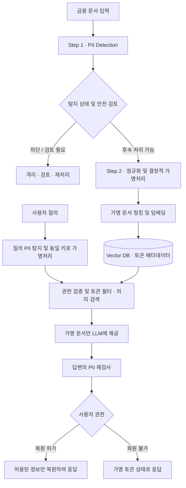

# AegisRAG

### Privacy-Preserving Retrieval-Augmented Generation for Financial Documents

금융 문서 속 개인정보를 탐지·가명처리한 후, **원문 개인정보를 외부 임베딩·LLM API에 전달하지 않고도 문서를 검색하고 답변하는 RAG 시스템**을 목표로 하는 프로젝트입니다.

> **프로젝트 배경**: 멋쟁이사자처럼 NLP 6기 · 클라비 기업 프로젝트\
> **개발 방식**: 실전 1(PII 탐지) → 실전 2(가명처리 기반 RAG) → 종합(접근 통제 및 출력 보호)\
> **현재 상태**: Step 1 탐지기 패키지 구현 · Step 2 및 통합 서비스 개발 예정

## 1. Why AegisRAG?

금융사의 상담 기록·민원·업무 메일·회의록에는 고객 이름, 연락처, 주민등록번호, 계좌·카드번호 등의 개인정보가 포함될 수 있습니다. 이를 그대로 벡터 DB나 외부 LLM에 전달하면 개인정보가 노출될 위험이 있습니다.

반면 모든 개인정보를 `***`로 단순 마스킹하면 동일 고객의 여러 문서를 연결하는 정보까지 사라져, **“특정 고객의 상담 이력 검색”** 같은 작업이 어려워집니다.

AegisRAG는 **개인정보 보호와 문서 활용의 양립**을 목표로 합니다.

- **Detect** — 문서에서 개인정보 구간과 유형을 식별
- **Pseudonymize** — 동일한 값을 일관된 가명 토큰으로 치환하고 원문 매핑을 분리 관리
- **Retrieve** — 가명 토큰 필터와 의미 검색으로 관련 문서를 탐색
- **Protect** — 접근 권한을 확인하고 답변을 재검사한 뒤 허용 범위 내에서 결과를 표시

## 2. End-to-End Architecture



위 그림은 **목표 통합 아키텍처**입니다. 현재 저장소에서 구현이 확인된 부분은 Step 1이며, Step 2·통합 서비스는 진행에 따라 추가됩니다. 실제 외부 전송은 탐지 완료만으로 허용되지 않으며, 가명처리 완료와 안전 검증을 별도로 통과해야 합니다.

Step 1은 Strict 평가용 `entities`와 기존 탐지 구간을 보존하는 `mask_intervals`를 별도로 반환합니다. Step 2 비식별화는 `entities`가 아니라 반드시 `mask_intervals`를 사용해야 합니다. `REVIEW_REQUIRED`는 검토 경로로 보내고 `BLOCKED` 결과는 후속 처리하지 않습니다.

## 3. Project Stages

| 단계 | 핵심 태스크 | 주요 산출물 | 진행 상태 |
|---|---|---|---|
| **Step 1 · PII Detection** | 개인정보 탐지 모델 비교·선정, Span 추출, 경계 보정 및 실패 차단 | 재사용 가능한 Hybrid 탐지기 패키지, 평가 코드 | **구현 완료** |
| **Step 2 · Pseudonymization & RAG** | 정규화, 결정적 가명 토큰, Vault 분리, 가명 데이터 적재 및 검색 | 가명처리 모듈, 기본형 검색·답변, 검색 평가 | **개발 예정** |
| **Integrated Service** | 문서 단위 접근 통제, 권한별 실명 복원, 출력 재검사, 통합 평가 | API/서비스, 안전성 및 검색 품질 평가 | **개발 예정** |

### Step 1: Hybrid PII Detector

팀의 초기 **RoBERTa 탐지기**를 기준선으로 설정해 평가한 뒤, 한국어 개인정보 탐지 모델 **A.X / Veil**을 금융 문서에 맞춰 파인튜닝하고 라벨별 강점에 따라 결합한 최종 탐지기를 구성했습니다. 개인정보가 누락되거나 탐지가 불확실한 사례를 다루기 위해 보수적인 Span 검증과 `REVIEW_REQUIRED` / `BLOCKED` 상태를 제공합니다. 결과에서 평가용 `entities`와 보수적 비식별화 입력인 `mask_intervals`를 분리하며, 후속 단계는 `mask_intervals`를 사용해야 합니다.

**탐지 대상(현 구현):** 사람 이름, 전화번호, 이메일, 주소, 주민등록번호, 계좌번호, 카드번호 — 총 7종.

[Step 1 상세 기술 및 실험 결과](step1_pii_detector/README.md)

### Step 2: Deterministic Pseudonymization & Retrieval

탐지된 정보를 라벨별로 정규화하고 **HMAC 기반 결정적 토큰**으로 치환하는 것을 목표로 합니다. 토큰-원문 대응 관계는 RAG 검색용 데이터와 분리해 관리하고, 질의에도 같은 변환을 적용하여 **토큰 필터 + 의미 검색**으로 문서를 찾습니다. 실제 구현 방식과 평가 수치는 개발 후 업데이트합니다.

### Integrated Service: Access Control & Output Safety

문서 접근 권한을 검색 전에 검증하고, 생성된 답변에서 개인정보를 재검사한 뒤, 권한이 확인된 사용자에 한해 필요한 정보만 복원하는 구조를 목표로 합니다.

## 4. Repository Structure

```text
AegisRAG/
├── README.md                      # 전체 프로젝트 소개 (이 문서)
├── step1_pii_detector/           # 개인정보 탐지 패키지 [현재 구현]
│   ├── README.md                 # 탐지 로직 · 성능 · 실행 방법
│   ├── src/pii_detector/         # detector · 모델 백엔드 · 팩토리
│   ├── tests/                    # 회귀 · 경계 · 구조 정책 · 런타임 안전성 검사
│   ├── evaluation/               # 탐지 성능 및 저장 예측 재채점
│   └── pyproject.toml            # 설치 및 의존성 정의
├── step2_pseudonymization/       # 가명처리 / 검색 구현 [추후 추가]
└── integrated_service/          # 인증 / 권한 / 출력 검증 [추후 추가]
```

> 현재 GitHub `main` 브랜치에는 이 프로젝트 안내와 `step1_pii_detector/` 구현이 포함되어 있습니다. 나머지 컴포넌트는 예정 구조이며, 구현한 뒤 추가합니다.

## 5. Technical Focus

| 분야 | 기술 또는 설계 방향 | 상태 |
|---|---|---|
| PII Detection | PyTorch · Transformers · A.X / Veil Token Classification | 구현 |
| Inference Optimization | Veil FP32 ONNX Runtime(CPU), A.X Torch 추론 | 구현 |
| Safe Inference | 라벨별 라우팅, 경계 검증, 긴 문서 Window, Fail-closed | 구현 |
| Pseudonymization | 정규화 + HMAC 기반 결정적 토큰 | 계획 |
| Retrieval | PostgreSQL / pgvector, 메타데이터 필터 + 의미 검색 | 계획 |
| Service Security | Vault 분리, 권한별 복원, 출력 PII 재검사 | 계획 |

## 6. Getting Started

현재 실행 가능한 컴포넌트는 Step 1입니다. Python **3.10~3.12** 환경이 필요하며, 모델 가중치는 공개 저장소에 포함되지 않습니다. 비공개 Hugging Face 모델 접근 권한과 개인별 읽기 토큰이 필요합니다.

```bash
git clone https://github.com/kohjunseo1/AegisRAG.git
cd AegisRAG/step1_pii_detector
python -m pip install -e .
```

자세한 모델 초기화, Python 사용 예시 및 단위 테스트는 [Step 1 README](step1_pii_detector/README.md)를 참고하세요.

## 7. Data & Security Principles

- 교육용으로 제공된 **합성 금융 문서**를 대상으로 연구합니다. 실제 고객 문서를 이 저장소에 올리지 않습니다.
- `.env`, API 키, Hugging Face 토큰, 모델 가중치, 원문-토큰 매핑(Vault)은 Git에 포함하지 않습니다.
- **탐지 결과가 `READY_FOR_PSEUDONYMIZATION`이어도 즉시 외부 전송이 허용되는 것은 아닙니다.** 가명처리·재검사·권한 검증은 별도 단계입니다.
- 정확도 평가는 평가 데이터와 튜닝 여부를 구분해 기록하며, 이미 오류를 분석한 Holdout에서의 후처리 개선을 독립 블라인드 성능으로 소개하지 않습니다.

## 8. Roadmap

| 구분 | 다음 작업 |
|---|---|
| Step 1 | 팀 환경에서 비공개 모델 로딩 및 배포 스모크 테스트, 운영 제약 추가 확인 |
| Step 2 | 탐지기 연결, 결정적 가명처리, Vault 분리, 검색 평가 |
| Integrated | 접근 통제, 출력 재검사, 권한별 복원, End-to-End 평가 |

---

**AegisRAG**는 개인정보 탐지 정확도뿐 아니라 **후속 처리의 안전성, 재사용 가능한 모듈 구조, 검색 품질**을 함께 고려하는 개인정보 보호형 RAG 프로토타입 프로젝트입니다.
