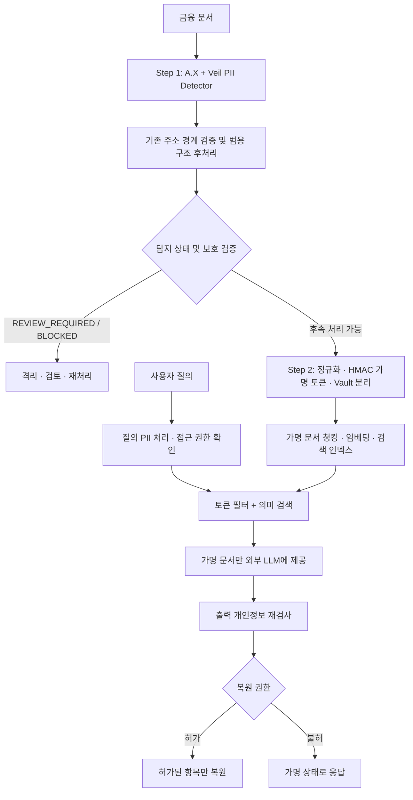

# AegisRAG

### Privacy-Preserving Retrieval-Augmented Generation for Financial Documents

AegisRAG는 금융 문서 속 개인정보를 탐지하고 결정적으로 가명처리한 뒤, **원문 개인정보가 외부 임베딩·LLM API로 전달되지 않도록 제어하면서** 관련 문서를 검색하고 답변하는 RAG 시스템을 목표로 합니다.

> **프로젝트:** 멋쟁이사자처럼 NLP 6기 · 클라비 기업 프로젝트<br>
> **개발 단계:** Step 1 개인정보 탐지 → Step 2 가명처리 기반 RAG → 통합 접근 통제·출력 보호<br>
> **저장소 현황 (2026-11-02):** Step 1 A.X + Veil 탐지 패키지 구현. Core Structural Policy 2규칙과 `mask_intervals` API가 feature branch에 통합되어 오프라인 회귀를 통과했습니다. 실제 모델 재추론과 Step 2 연동은 미검증이며, Step 2 및 통합 서비스는 아직 구현되지 않았습니다.

## 1. 문제 정의

상담 기록, 민원, 보험·금융 업무 메일에는 이름, 연락처, 주민등록번호, 계좌·카드번호, 주소 등의 개인정보가 포함될 수 있습니다. 원문을 그대로 벡터 DB 또는 외부 LLM으로 보내면 개인정보 노출 위험이 생깁니다. 반대로 모든 개인정보를 일괄 `***`로 마스킹하면 동일한 고객의 문서들을 연결하여 검색하기 어렵습니다.

AegisRAG는 다음 네 기능을 순차적으로 구현합니다.

1. **Detect** — 금융 문서의 개인정보 유형과 문자 구간(`label`, `start`, `end`) 탐지
2. **Pseudonymize** — 동일한 정규화 값은 일관된 가명 토큰으로 치환, 원문 매핑은 별도 Vault에 격리
3. **Retrieve** — 권한을 확인하고 가명 토큰 메타데이터 + 의미 검색으로 문서 조회
4. **Protect** — 외부 전송 전 보호 여부 확인, 답변 재검사 및 권한별 제한적 복원

## 2. 목표 End-to-End 아키텍처



**위 그림은 목표 설계**입니다. 현재 GitHub에서 확인되는 실행 가능한 구현은 Step 1 패키지입니다. `READY_FOR_PSEUDONYMIZATION`은 탐지 성공 상태일 뿐, 외부 전송 허가가 아닙니다. 실제 전송은 Step 2 가명처리와 별도 안전 검증을 마친 후에만 허용하도록 설계합니다.

## 3. 프로젝트 진행 현황

| 단계 | 주요 기능 | 코드 확인 상태 |
|---|---|---|
| **Step 1 · PII Detection** | A.X/Veil 백엔드, 라벨별 라우팅, 주소 경계 검증, 긴 문서 Window, 실패 차단, 평가기 | **구현** |
| **Step 1 · Core Structural Policy** | 성씨 1글자+직함, 명시적 짧은 내선번호 Strict span 정제, 보수적 `mask_intervals` 계약 | **feature branch 통합 및 오프라인 회귀 완료; 실모델 검증 대기** |
| **Step 2 · Pseudonymization & RAG** | HMAC 기반 결정적 가명처리, Vault 분리, 가명 인덱스, 검색 평가 | **개발 예정** |
| **Integrated Service** | 접근 통제, 제한적 복원, 출력 검증, End-to-End 안전성 테스트 | **개발 예정** |

Step 1 상세 구조, 설치법, 실험 재현 범위는 [Step 1 기술 문서](step1_pii_detector/README.md)를 참고하세요.

## 4. Step 1 탐지 구조와 평가

### 현재 구현

- **A.X**: `person`, `phone_number`, `email`, `resident_registration_number`, `account_number`, `card_number` — PyTorch
- **Veil**: `address` — FP32 ONNX Runtime/공식 디코더
- 고정된 모델 리비전은 `step1_pii_detector/src/pii_detector/model_manifest.json`에서 관리
- 공통 문자열 오프셋 `[start, end)`, 라벨별 결합, 중첩 제거, 조건부 주소/우편번호 경계 검증, 모호한 이름 경계 검토
- feature branch에서 `standalone_surname_title` 및 `explicit_internal_extension`만 Strict `entities`에서 제외하며, 원래 후보도 `mask_intervals`에서 보호
- 타임아웃·잘못된 입력·리소스 한도 초과 시 `BLOCKED`, 검토 필요 시 `REVIEW_REQUIRED`

### 성능 기록: 서로 다른 평가 단계 구분

| 데이터 | 정책/단계 | Strict F1 | Mask Recall | 해석 |
|---|---|---:|---:|---|
| Official Test, 200문서 | 최초 동결 Hybrid(05) | **99.23%** | **99.97%** | 저장 예측 및 Gold로 재채점한 기준선 |
| Official Holdout, 187문서 | **최초** 동결 Hybrid(05) | **97.73%** | **99.48%** | Holdout 오류를 보기 전 성능 |
| Official Holdout | 기존 조건부 우편번호 보정 | **98.27%** | **100.00%** | Holdout을 본 후의 **사후 개선** |
| Official Test | 현재 저장소 주소 검증 + 신규 2규칙, 저장 예측 재채점 | **99.36%** | **99.97%** | 오프라인 후처리 결과; 실제 detector 추론 아님 |
| Official Holdout | 신규 2규칙만, 저장 예측 재채점 | **98.80%** | **99.48%** | 주소 보정 미포함, 사후 분석 |
| Official Holdout | 현재 저장소 주소 검증 + 신규 2규칙, 저장 예측 재채점 | **99.3450%** | **100.00%** | 오프라인 후처리 결과; 실제 detector 추론 아님, 사후 분석 |

> **핵심 주의:** 처음 본 Holdout 결과와 Holdout 오류를 분석한 후의 결과는 구별해야 합니다. 위 사후 결과는 새 미공개 데이터에서의 99% 일반화 성능을 입증하지 않습니다. 또한 V9 Full 6규칙의 Holdout 99.89%는 측정된 실험 기록이지만, 과도한 문맥 의존성을 피하기 위해 **배포 정책으로 채택하지 않았습니다**.

위 신규 정책 수치는 명시된 05 저장 예측에 후처리를 적용한 **오프라인 재채점 참고값**입니다. 실제 `create_detector()`/`detect()` 모델 추론으로 재생성한 결과가 아니므로 최종 배포 성능으로 보지 않습니다. 실제 모델 평가 전에는 통합 버전의 99% 달성을 주장하지 않습니다.

## 5. 저장소 구조

현재 feature branch 파일/폴더:

```text
AegisRAG/
├── README.md
├── .gitignore
└── step1_pii_detector/
    ├── README.md
    ├── STRUCTURAL_POLICY_VALIDATION.md
    ├── .gitignore
    ├── pyproject.toml
    ├── .env.example
    ├── src/pii_detector/
    │   ├── __init__.py
    │   ├── detector.py
    │   ├── factory.py
    │   ├── backends.py
    │   ├── loader.py
    │   ├── structural_policy.py
    │   └── model_manifest.json
    ├── tests/
    │   ├── test_detector_boundaries.py
    │   ├── test_detector_runtime.py
    │   ├── test_detector_reference_parity.py
    │   ├── test_structural_policy.py
    │   └── test_offline_regression.py
    └── evaluation/
        ├── run_compare.py
        └── offline_regression.py
```

`step2_pseudonymization/` 및 통합 서비스 디렉터리는 목표 구성으로서 아직 저장소에 없습니다. Core Policy는 feature branch에서 통합됐지만 PR은 Draft이며 실제 모델 및 Step 2 검증이 남아 있습니다.

## 6. 실행 방법

Python **`>=3.10,<3.13`**, Private Hugging Face 리포지토리 두 곳에 대한 읽기 권한 및 `HF_TOKEN`이 필요합니다. 모델 파일과 토큰은 GitHub에 포함되지 않습니다.

```bash
git clone https://github.com/kohjunseo1/AegisRAG.git
cd AegisRAG/step1_pii_detector
python -m pip install -e .
python -m unittest discover -s tests -v
```

```python
from pii_detector import create_detector

with create_detector() as detector:
    result = detector.detect("고객명: 홍길동, 연락처: 010-1234-5678")
    print(result["status"], result["entities"])
```

`HF_TOKEN`은 실행 환경의 비밀값 또는 Git에서 제외되는 `.env`로 설정합니다. 초기 실행은 Private Hugging Face 모델을 다운로드하고 Veil ONNX를 준비합니다. 오프라인 평가 도구에는 Gold와 저장 예측의 명시적 파일 경로를 전달합니다. 파일을 Colab 원격 커널에서 사용할 때는 해당 커널에서 실제 접근 가능한 경로를 지정해야 합니다.

## 7. Step 1 → Step 2 API 및 보안 계약

feature branch의 탐지 결과는 다음 필드를 구분해 반환합니다.

- `entities`: 라벨과 경계가 정확한 **평가·구조화용** Span
- `mask_intervals`: **실제 가명처리용** 보호 구간. 후처리로 제외된 Strict 후보의 원래 탐지 구간도 보존
- `status`: `READY_FOR_PSEUDONYMIZATION` / `REVIEW_REQUIRED` / `BLOCKED`

`mask_intervals`는 합성 mock pseudonymizer 테스트에서 적용을 확인했습니다. Step 2 코드는 아직 없으므로 실제 호출부의 계약 검증은 미완료입니다. Step 2는 반드시 이 필드를 검증하고, 누락·오류 시 fail-closed 해야 합니다. `entities`만 이용해 보호 범위를 축소하거나, `READY_FOR_PSEUDONYMIZATION`만 보고 외부로 전송해서는 안 됩니다.

모든 원문-토큰 매핑은 검색 인덱스 및 Git 저장소와 격리합니다. 실험에서는 합성 데이터를 사용하며, 실제 개인정보를 커밋하거나 외부 서비스로 보내지 않습니다.

## 8. 다음 단계 및 완료 기준

1. **실모델 성능 재현:** 고정 모델 revision으로 Official Test/Holdout API 평가를 실행하고 오프라인 저장 예측 재채점과 구분
2. **Step 1 안전성 검증:** `mask_intervals` 미마스킹·과잉 마스킹, 상태 처리, 긴 문서, 동시성·타임아웃 확인
3. **Step 1 버전 동결:** 코드 SHA·모델 revision·평가 분할·사후 보정 여부 기록 후 승인
4. **Step 2 착수:** `mask_intervals` API를 실제 가명처리에 연결하고 필드 누락·검토·차단 상태에서 외부 전송 차단

실제 운영 가능 여부는 F1만이 아니라 개인정보 유형별 미탐, 과잉 마스킹, 사용자 검토 비율, p95 지연시간 및 외부 전송 통제로 판단합니다. 어떤 미래 데이터에서도 탐지율 100% 또는 Strict F1 99%를 보장하지 않습니다.

---

**AegisRAG**는 탐지 성능과 보안 실패 처리, 문서 검색 품질을 함께 검증하는 개인정보 보호형 RAG 프로젝트입니다.
