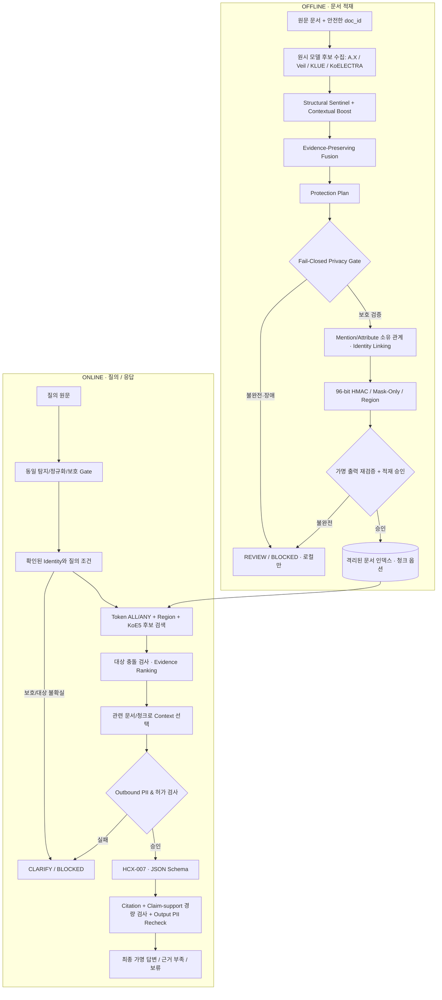

# AegisRAG Unified V1 — 자율 순차 구현·검증 설계서 (Codex Overnight Mode)

> **검토본:** 2026-11-19 · **상태:** 자율 순차 구현용 최신 실행 명세 · **원본:** `AegisRAG_Unified_V1_Implementation_Blueprint.md`
> **범위:** 실전 1·2 통합 — PII 탐지 → 후보/경계 판정 → Privacy Gate → HMAC 가명처리 → 문서 인덱싱 → 질의 처리/검색 → HCX-007 → 출력 보호·인용 검증.
> **이번 V1 범위 밖:** 로그인·직원/팀 추론·ACL·실명 복원·권한 UI. 다만 확장을 위한 `doc_id`/개체 ID/상태/버전 계약은 먼저 설계.
> **확정 요구:** HMAC-SHA256 **96-bit = 24자리 hex** 유지, 답변 생성 모델 **HCX-007** 사용.
> **실행 우선순위:** 아래 **「0A. 현재 실제 환경」 및 「10. 자율 실행 규칙」**이 앞선 수동 단계 지시보다 우선한다.
> **주의:** 이 문서는 Codex의 **작업 명세**다. 모델 네 개의 통합 E2E 성능, 신규 Blind 일반화 성능, 모델 가중치 호환성이 이미 증명됐다는 뜻이 아니다.

---

## 0. 원본 검토 결과: V1 구현 전에 고친 핵심 문제

| 우선순위 | 기존 MD의 내용/빈틈 | 실제 코드 확인 및 위험 | 이번 수정 결정 |
|---|---|---|---|
| **P0 치명** | 4모델 어댑터만 만들면 바로 재현 가능 | 팀원 체크포인트 `models/roberta_small_v1`, `models/koelectra_ft5`는 GitHub에 **없음**. 학습 모델 전체 폴더를 별도로 확보해야 함 | 파일 인수·SHA-256·라벨/토크나이저/오프셋·고정 예측 비교를 **P0 재현성 게이트**로 추가 |
| **P0 치명** | 모델을 한 Python 환경에서 병렬 실행 | AegisRAG 고정 `torch==2.2.2`, `transformers==4.55.4` vs 팀원 `torch==2.11.0`, `transformers==5.20.2`; 통합 설치 시 깨질 수 있음. macOS Intel의 패키지 wheel도 미확인 | 기존 Aegis 환경 절대 변경 금지. 별도 환경 호환 PoC → 불가하면 로컬 별도 추론 프로세스/IPC 사용 |
| **P0 치명** | 통합 결과를 main에서 교체 | 정상 동작하는 `main`, 187행 운영 DB, HMAC/토큰 버전이 오염될 수 있음 | `feature/unified-v1` **독립 worktree/브랜치 → PR → CI/실모델/E2E 승인 → main 병합**. 기존 DB 불변 |
| **P0 치명** | `quality4`가 '품질 상한' | 4모델 합집합은 오탐·REVIEW 증가 가능. 저장 예측의 '완전 미탐 0'은 실출력 완전 보호 0과 다름 | **품질 비교용 참조 후보**이지 운영 최적·이론적 상한이라고 단정 금지 |
| **P1 중요** | 팀원 `detect_with_review()`와 원래 `detect()`를 그대로 사용 | `detect_with_review()`는 `P.HYBRID` 전역 상태를 일시 변경, 원래 `detect()`는 환경변수 의존·후처리·후보 삭제를 포함 | 모델 **원시 추론 어댑터**를 분리. 요청 중 전역 설정 변경 금지. 기존 원본 코드는 읽기 전용 유지 |
| **P1 중요** | raw Span 캐시 재생 후 모든 실험 비교 | 팀원 `span_cache.py`는 선택적 미스 fallback, 텍스트 `rstrip()` 재조회, `PII_SPANS_FILTER` 적용을 지원함 | **캐시 히트 필수/설정 해시 필수/원문 SHA 일치/정책 후처리 없음**. 모델 후보 캐시와 최종 Span 캐시 분리 |
| **P1 중요** | 문서/질의 동일 보호 로직 | AegisRAG `document_preparation.py`는 `doc_id.startswith('Q')`로 Query Region을 추가함. ID 형식으로 입력 종류 판단하면 일반화·재현성이 나쁨 | 새 계약은 명시적인 `input_kind=document\|query`; 기존 동작과 회귀 비교 후 점진 전환 |
| **P2 중요** | `READY_MASKED_ONLY`를 쉽게 자동 적재 | 현행 `dataset_workflow.py`는 `LOCAL_PREPARED` 이후 `unlinked_mentions==0`를 자동 적재 요건으로 둠 | Mask-only는 **별도 실험적 승인 경로**, 초기 `index_mask_only=false`; 보호/잔여/권한·승인 계약 검증 후 단계적으로 허용 |
| **P2 중요** | 이름/번호 HMAC 키 통합 | 팀원은 숫자에 공통 `num` 네임스페이스+8 hex; Aegis는 라벨별 24 hex. 팀원 정규화도 다름 | 96-bit **기존 구현/정규화/HMAC 키는 동결**. 새 숫자 별칭·개체 키는 별도 네임스페이스/버전/실험 플래그 |
| **P3 중요** | PersonResolver 직접 이식 | 두 코드 모두 역할·소속만으로 병합하거나 문서 내 이름만으로 같은 사람 가정하는 경로가 있음 | **Mention과 Entity 분리**, 명시적 소유 관계 + 충분한 식별 근거 없으면 `UNRESOLVED`; 오연결을 보호 누락보다 별도 평가 |
| **P4 중요** | `team_v3` 검색이 Aegis 테이블에서 그대로 동작 | 팀원은 `rag.chunks` 600자·GIN Token·청크 임베딩, Aegis는 `rag.aegis_live_docs` 문서 단위 1024차원 KoE5 | 공통 읽기 모델/실험 전용 테이블 도입. **순위 로직 재구현**이지 SQL을 무작정 복사하지 않음 |
| **P5 중요** | 출력 `recheck` 추가만 하면 안전 | Aegis HCX에 기존 송신 전·후 패턴 검사 있음. 팀원 recheck는 토큰 패턴/라벨이 8자리 기준 일부 가정 | 기존 `hcx.py` 검사 유지 + **96-bit 토큰에 맞춘 독립 탐지 재검사**. 실패 시 원문·응답 로깅 금지 |
| **P6 중요** | 171개 'Blind'로 운영 모델 선택 | 두 팀이 이미 171문서/187문서 실패를 분석함 | `seen_dev`로 재분류. 신규 독립 Blind는 **프로파일 고정 후 1회 평가**, 이후 분석하면 더 이상 untouched가 아님 |

### 0.1 이번에 확인된 기준 커밋

| 기준 소스 | 저장소 / 브랜치 | 고정 SHA |
|---|---|---|
| 통합 작업 기반 | [`kohjunseo1/AegisRAG`](https://github.com/kohjunseo1/AegisRAG) `main` | `644ab9d56cd24d5386c739712488299448940d26` |
| 팀원 코드의 이식 소스 | [`8bitHermitcrab/privacy-rag-chatbot`](https://github.com/8bitHermitcrab/privacy-rag-chatbot/tree/feature/detect) | `242543bf0eae91aa3d655227a747aa128707368e` |

> Codex는 실제 작업 시작 시 `git fetch` 후 HEAD를 재확인하고, 다르면 **무작정 최신으로 변경하지 말고** `source_manifest`에 변경점을 기록할 것. 팀원 저장소의 **default `main`이 아닌 `feature/detect`**를 읽어야 함.

### 0.2 실측과 미검증 구분

- 상대 MD `integrated_pipeline_v1_v2(1).md`의 171문서 1,439 Gold 중 A(4모델) '완전 미탐 0건'은 **저장 예측 기반 zero-overlap** 평가. Gold 문자 중 가려지지 않은 수, Strict F1, 최종 가명처리 출력은 별개 측정 필요.
- 같은 MD의 Holdout 검색 Hit@5=1.000/MRR=0.918은 **캐시 기반 재구성의 보고치**. 새로운 Fusion/Gate/HMAC/DB/HCX가 통합된 실측 결과 아님.
- AegisRAG 187/88 검색 `77/85` Hit@1, `83/85` Hit@5와 팀원 평가값의 **서로 다른 분모·정규화·인덱스**를 직접 비교하지 말 것.
- '금 재원'은 상대 MD가 171문서 비교에서 보고한 사례이나 원시 Gold/Span/가명처리 결과를 이 저장소의 공개 파일만으로 재현하지 못함. 문서 식별자/내용을 임의로 추정하지 말 것. 케이스가 실제로 존재하는지 **로컬 비공개 예측 파일로 검증**하고, 별도로 같은 패턴의 합성 회귀 예문 생성.
- 4팀의 보고 점수와 비교 시 공통 데이터/분모/답변 모델/Gold 노출 여부를 표시. 4팀은 Holdout 외 어려운 이름·추가 인물 평가도 했으므로 '4팀은 무조건 Holdout 과적합'이라고 단정하지 않는다.

---

## 0A. 현재 실제 환경 — 2026-11-19 재확인 (Codex가 반드시 먼저 읽을 것)

> 사용자가 이미 수행한 준비를 **다시 실행하지 않는다.** 아래는 사용자가 터미널에서 확인한 상태이다. Codex는 시작 시 읽기 전용 명령으로 사실 여부를 재검증하며, 다를 때만 원인을 기록한다.

| 항목 | 현재 사실 | Codex 조치 |
|---|---|---|
| 현재 개발 worktree | `/Users/gojunseo/AegisRAG-unified-v1` (명령에서 생성한 경로) | `pwd`, `git status -sb`, `git rev-parse HEAD` 확인. 이 폴더 아닌 경우 작업 전 정확한 루트 확인 |
| 통합 브랜치 | `feature/unified-v1`가 `origin/main`의 `644ab9d`에서 생성되어 추적 중 | 이미 생성되었으므로 **다시 브랜치 생성·reset·rebase 금지** |
| 로컬 `main` | `git rev-list --left-right --count origin/main...main` 결과 `8 0` | 원격 `main`이 로컬 `main`보다 8커밋 앞섬. **충돌 아님**. 기존 main이 다른 worktree에 체크아웃되어 있으니 업데이트하지 말 것 |
| 팀원 참조 코드 | `../privacy-rag-chatbot-reference`, `feature/detect` SHA `242543bf0eae91aa3d655227a747aa128707368e` | **이미 clone 완료**. 수정·push 금지, 필요한 코드·동작만 참조. 폴더 없다면 P0 보고 후 fetch/clone 필요 여부 판단 |
| 팀원 KLUE 파일 | `/Users/gojunseo/private-models/aegisrag/roberta_small_v1/` | `config.json`, `tokenizer_config.json`, `tokenizer.json`, `model.safetensors` 4파일 존재. 파일 구성은 확인됐으나 **실제 추론·원본 예측 동등성은 미검증** |
| KLUE 전달 ZIP | `drive-download-20261118T152143Z-1-001.zip` | **이미 압축 해제 완료**. 다시 unzip하지 말 것; 파일 원문·가중치 Git에 추가 금지 |
| KoELECTRA | `koelectra_ft5` 체크포인트 **미입수** | Adapter·구조·mock 테스트는 작성, 실모델 검증은 `MISSING`/`BLOCKED`. 공개 `atonlee`로 조용히 대체 금지 |
| 기존 Aegis 모델 | HF pinned A.X/Veil, 개인 권한 필요 | 원본 manifest 유지. HF 접근이 불가하면 mock/offline tests 수행하고 blocked로 표시 |
| 환경 충돌 | Aegis `torch 2.2.2` / `transformers 4.55.4`, 팀원 `torch 2.11.0` / `transformers 5.20.2` | 기존 가상환경 무수정. 별도 버전 호환 PoC. 실패하면 프로세스 분리 어댑터 **설계/구현**만 수행, 실측 성공 주장 금지 |

**주의:** 상기 KLUE 모델 폴더는 4파일 총 약 271 MB의 HF 로컬 체크포인트로 보인다. `config`의 세부 라벨·토크나이저 타입, `from_pretrained` 호환성, 실제 출력은 반드시 로컬 테스트로 검증해야 한다. 모델 파일 경로는 **repository 밖**에 보존. 모델 실행 시 사용자 텍스트·토큰·비밀 키를 출력하지 않는다.

**Git 상태 해석:** `## feature/unified-v1...origin/main`은 작업 브랜치가 원격 main을 추적한다는 뜻이며, `8 0`은 **로컬 main이 원격 main보다 8커밋 뒤처졌다**는 뜻이다. `feature/unified-v1`에 잘못된 커밋이 섞였다는 뜻이 아니다.

---

## 1. Git 개발 전략 — 사용자 질문에 대한 최종 결정

**맞음. 개인 AegisRAG의 새 브랜치를 실험·통합의 단일 개발 저장소로 사용하고, 완성되면 PR로 main에 합친다. 단, `main` 파일을 전량 삭제 후 대체하지 않는다.**

### 1.1 권장 브랜치/작업 구조

```text
kohjunseo1/AegisRAG
├── main                         ← 기존 V6 기준선/운영 서비스 보존
└── feature/unified-v1           ← 새 통합 코드·테스트·설정·문서
        ├── source_adapters/     ← 팀원 원본 로직의 검증된 부분 이식
        ├── fusion/              ← 후보 보존·근거 판정·Gate 연동
        ├── identity/            ← Mention / Anchor / Linking
        ├── retrieval/           ← V6/v3/hybrid 비교 가능
        └── evaluation/          ← 동일 데이터·동일 채점기·재현 보고서

8bitHermitcrab/privacy-rag-chatbot  feature/detect 242543b
└── 읽기 전용 비교 원본 (fork/서브모듈로 자동 병합하지 않음)
```

- 파일 경로는 개념 예시. 새 최상위 패키지를 무턱대고 만들기 전에 기존 패키지의 import/테스트/실행 진입점을 확인해 **최소 변경 설계**를 선택.
- `main` 기존 실행 경로는 기본값으로 유지한다. `unified_v1`은 명시적 플래그/별도 CLI로 활성화해 **A/B 비교 및 즉시 롤백** 가능하게 한다.
- 기존 릴리스 기준선은 커밋 SHA와 optional annotated tag로 고정하고, 테스트·비밀값·DB 상태는 코드를 이전 버전으로 돌린다고 자동 복원되는 것이 아님을 명시한다.
- 통합 구현 중 DB/모델/HMAC 키 변경은 **기존 운영 187행과 무관한 별도 스키마·환경·인덱스**에서만 실행한다.

### 1.2 안전한 로컬 Git 명령 예시

> **전제:** 현재 로컬에 미커밋 변경이나 활성 worktree/기존 feature 브랜치가 있을 수 있다. 아래는 Codex가 `git status`와 경로를 확인한 후에만 실행. 기존 작업 디렉터리를 자동 덮어쓰지 말 것.

```bash
cd /path/to/AegisRAG
git status --short
git branch --show-current
git rev-parse HEAD
git fetch origin

# 기존 worktree를 건드리지 않고 별도 통합 작업 공간 생성
# feature/unified-v1 브랜치가 없고 대상 경로도 비어 있을 때만:
git worktree add -b feature/unified-v1 ../AegisRAG-unified-v1 origin/main

# 팀원 원본은 별도 위치에 해당 커밋만 체크아웃하여 읽기 전용으로 참조
git clone --branch feature/detect --single-branch \
  https://github.com/8bitHermitcrab/privacy-rag-chatbot.git \
  ../privacy-rag-chatbot-reference
cd ../privacy-rag-chatbot-reference
git rev-parse HEAD  # 기대: 242543bf0eae91aa3d655227a747aa128707368e
```

- `feature/unified-v1` 또는 경로가 이미 있으면 새로 만들지 말고 상태를 확인한다. `git reset --hard`, `git clean -fd`, 강제 push, `--force-with-lease`, 팀원 저장소에 push **금지**.
- `main`이 기대 기준 SHA와 달라진 경우 변경 내용을 검토하고 기준선을 갱신하거나 고정 SHA에서 새 브랜치를 만들지 결정한다. 서로 다른 기준선을 조용히 섞지 않는다.
- 코드 이식 시 **파일별 출처 경로, 원본 commit, 수정 사유**를 `docs/unified_v1/SOURCE_MAP.md`에 기록한다. 라이선스/모델 배포조건/저작권 표시도 확인한다.

### 1.3 PR → main 승격 기준

1. 기존 V6 테스트/CI가 모두 통과하고 기존 실행 경로가 동등하게 작동할 것.
2. 팀원 로컬 체크포인트 **동일 예측 재현**(아래 P0 게이트)이 성공했을 것. 성공 못한 모델은 품질 프로파일에 숨겨 넣지 않음.
3. 새 V1에서 탐지·가명처리·검색·HCX 로컬 모의 E2E 및 승인된 합성 실호출을 검증할 것.
4. 기존 `rag.aegis_live_docs` 내용/행 수/권한/HMAC key tag 변경 없음이 확인될 것.
5. 새 평가 리포트에 오탐, 누출 문자, 검수 비율, 검색 전체 분모, 실제 지연/메모리, 실패 케이스가 기록될 것.
6. 팀원이 PR 리뷰 후 **병합**. 필요하면 `main`의 기본 실행 프로파일을 후속 PR에서 V1로 바꾸고, 구 버전 플래그와 태그는 보존.

---

## 2. 모델 체크포인트 및 실행 환경 — 반드시 먼저 검증

### 2.1 모델 인수 체크리스트

| 모델 | 소스·확인된 로딩 방식 | 현재 파일 입수 상태 | 재현에 필요한 것 |
|---|---|---|---|
| A.X | HF `PII-detect/pii-ax-mixed-v1`, pin `c0f99b1dc113befefeff1a3091087d50bc3ea635`, `backends.py` | 비공개 HF 접근 권한 필요 | 개인 `HF_TOKEN` 접근, `best_model/` 포함한 pinned revision; 현행 Aegis 환경 유지 |
| Veil | HF `PII-detect/pii-veil-mixed-v1`, pin `e6e7d20fa9baa43a938f5f6cc780d3f2c9650fb9`, 런타임 ONNX 변환 + 공식 `veil.py` | 비공개 HF 접근 권한 필요 | tokenizer + config + weights + `veil.py`, pinned revision; 기존 FP32 검증 유지 |
| KLUE | 팀원 로컬 `models/roberta_small_v1`, `pii_pipeline._load_model()`에서 `AutoModelForTokenClassification.from_pretrained(local_path)` | **GitHub에 없음** | **전체 HF 형식 체크포인트 폴더**(아래), 팀원 파일 해시 및 환경 정보 |
| KoELECTRA | 팀원 `.env.example`: `PII_HYBRID_MODEL=models/koelectra_ft5`, `HFDetector` | **GitHub에 없음** | 파인튜닝된 모델 전체 폴더, `id2label`, tokenizer, SHA; 실제 사용 모델 확정 |

**중요:** KoELECTRA 코드의 `atonlee/koelectra-ko-pii-ner`는 **별도 기본 공개 모델 경로**다. `models/koelectra_ft5` 파일을 구하지 못했다고 이를 자동 사용하면 **상대 MD의 동일 실험 구성이 아니다**. 공개 모델로 대체 실험할 경우 `koelectra_public` 같은 **새 프로파일**과 별도 결과 기록 필요.

팀원에게 요청할 전달물(원문·HMAC 키·Gold 제외):

1. `roberta_small_v1/`와 `koelectra_ft5/`의 **완전한 파일 목록**. 보통 `config.json`, `model.safetensors` 또는 `pytorch_model.bin`, `tokenizer_config.json`, `tokenizer.json` 및 tokenizer에 필요한 `vocab`/`special_tokens_map` 파일 등이 필요. **정확한 필수 파일은 실제 `from_pretrained` 로딩으로 확정**.
2. 최종 학습 설정 및 **각 파일 SHA-256**, `model_type`, `num_labels`, `id2label`, `label2id`, 훈련에 사용한 Python/torch/transformers/tokenizers 버전.
3. 모델 경량/전체 가중치 구분. `adapter_model.safetensors` 같은 **PEFT/LoRA 어댑터만** 전달되면 원본 base checkpoint/adapter config까지 필요. `state_dict`만 있다면 같은 architecture 정의·설정으로 완전한 inference export를 받아야 함.
4. **모델별 작은 합성 문장 5~10개**에 대한 예상 출력: 라벨 + 원문 `[start,end)` + 선택적 점수. `금 재원`, `선우 님` 같은 패턴은 **합성 문장으로** 제작(실제 Blind 내용 복사 금지).
5. `.env.example` 기준의 **실제 실험 설정값**: `PII_HYBRID`, `TAU_ACCEPT`, `TAU_REVIEW`, `NUM_UNION`, `NAME_FILTER`, `BOOST_PERSON`, `BOOST_ADDRESS`, `ENSEMBLE`, `PII_SPANS_CACHE/FILTER`, Kiwi 활성 여부. 기본값과 당시 실행값이 다를 수 있음.
6. 모델 공유 권한·배포/재배포 허용 범위를 확인. 체크포인트 원본은 Git에 넣지 않고 별도 로컬 경로/승인된 저장소에서 전달.

### 2.2 로컬 파일 검증 체크

- **경로**: 팀원 모델 경로를 cwd 상대값으로 가정하지 말 것. `TEAM_KLUE_MODEL_DIR`, `TEAM_KOELECTRA_MODEL_DIR`에 **절대경로**를 지정하고 안전한 루트 밑인지 확인. `.env` 내용/키를 로그에 출력하지 말 것.
- **파일**: 가중치와 tokenizer/config 쌍을 같은 학습 산출물로 검증. 누락/해시 불일치면 `MODEL_ARTIFACT_MISMATCH`로 중단.
- **모델 구조**: `config.model_type`, `num_labels`, `id2label/label2id`, special tokens, vocab 크기, tokenizer `is_fast`, token type IDs 처리, 모델의 실제 forward signature 점검.
- **라벨**: BIO/BIOES를 7개 PII 타입으로 명시적으로 매핑. 알 수 없는 라벨은 **조용히 전체 매핑/성능 지표에서 제외하지 않고**, 허용된 ignore 목록인지 검사하고 보고. `organization` 등은 V1 스코프 밖임을 명시.
- **오프셋**: 공백 포함 이름/조사/긴 문서에서 원문 문자 인덱스를 보존. 팀원 `_chunks`는 긴 단일 줄이 tokenizer `truncation=True`에 의해 잘릴 수 있으므로 **조용한 잘림을 방지하는 토큰 길이 검사·windowing** 필수.
- **검증**: 같은 합성 문장에 원래 팀원 런타임과 새 Adapter를 돌린 예측 **동등성 테스트**. 일부러 정책을 바꾸는 것은 '후보 어댑터 동등성'과 '신규 Fusion 결과'를 나눠 측정.
- **성능**: 동일 기기에서 warm 30회 이상, 모델 로드 시간, p50/p95, peak RSS, 실제 프로세스별 RAM과 전체 메모리 확인. 수치는 실측 리포트에만 기록.

### 2.3 Python 의존성 충돌 해결 원칙

**확인된 사실:**

```text
AegisRAG requirements.lock: Python 3.11.13 (macOS x86_64 reference)
  torch==2.2.2, transformers==4.55.4,
  tokenizers==0.21.4, onnxruntime==1.23.2

팀원 requirements.txt:
  torch==2.11.0, transformers==5.20.2,
  numpy==1.26.4, fastapi==0.162.0, uvicorn==0.54.0
```

**실행 결정 트리:**

1. P0에서는 기존 Aegis 가상환경을 전혀 수정하지 않고, 팀원용 **별도 임시 venv**에서 **그 팀원이 사용하던 모델/설정으로** 로딩·출력 동등성을 검증.
2. '한 환경으로 합치기'는 별도 disposable 환경에 **양쪽 모델을 전부 올리고** 7종 라벨, tokenizer, Veil FP32 export, pytest 회귀를 통과할 때만 허용. `pip install -U`로 기존 환경을 덮어쓰는 일 금지.
3. 하나의 환경이 검증되지 않거나 macOS Intel wheel이 없으면 **모델 프로세스 2개 분리**(Aegis A.X/Veil / Team KLUE/KoELECTRA). 로컬 UNIX 도메인 소켓이 가능하면 우선 고려; 그렇지 않으면 `127.0.0.1`만 바인딩, 인증/요청 크기 제한/timeout/원문 로깅 금지. 외부 네트워크로 PII를 전송하지 않는다.
4. 프로세스 분리에서도 같은 요청의 모델 원시 후보를 **요청 ID와 원문 fingerprint로 일치 검증**; 일부 모델 timeout/오류 발생 시 `quality4`를 자동 `team2`로 다운그레이드하지 않고 `REVIEW/BLOCKED`.
5. 팀원 `P.HYBRID` 전역 변경, `_tok/_model` 전역 lazy initialization, `torch.set_num_threads` 공유 상태, 모델 재로드와 요청 동시성은 별도 검증. 서버에서는 요청마다 환경변수/전역 flag 변경 금지.

**P0 완료 기준:** 팀원 체크포인트가 없는 경우 Codex는 **mock/contract 테스트만 진행**할 수 있으나, 실제 4모델 동등성 및 171문서 성능 **미검증 상태를 명확히 남길 것**. 체크포인트를 상상해 만들거나 공개 모델로 자동 대체하지 않는다.

---

## 3. V1 전체 아키텍처 (오프라인/온라인 분리)



**순서 정정:** 'Gate를 통과하면 바로 Identity로 묶는다'라는 단순화는 부족함. 원시 문서 내 관계(개체와 전화 등의 **소유 관계**)는 **로컬 원문 처리 단계**에서만 추출할 수 있으므로, 원문 재노출 없이 Attribute Evidence를 수집하고 검증된 연결만 HMAC으로 반영한다. 실제 인덱스/외부 전송은 언제나 가명처리·승인 이후에만 허용.

---

## 4. 필수 공통 객체와 불변조건

### 4.1 타입 계약

```text
Candidate {
  source_id: ax|veil|klue|koelectra|structural|contextual,
  source_revision: str, label: 7-class PII label,
  start: int, end: int, offset_unit: unicode_codepoint,
  confidence_raw?: float, confidence_semantics?: str,
  evidence_codes: list[str], window_id?: str,
  original_input_fingerprint: str
}

DetectionEvidence {
  input_kind: document|query, request_id: str,
  raw_candidates_by_source: dict,
  model_status_by_source: dict[OK|ERROR|TIMEOUT|UNAVAILABLE],
  structural_candidates: list,
  config_hash: str
}

ProtectionPlan {
  strict_entities: list, entities_for_hmac: list,
  mask_intervals: list, redaction_intervals: list,
  unresolved_mentions: list, review_reason_codes: list,
  detector_profile: str, policy_version: str
}

PreparationResult {
  state: LOCAL_PREPARED|REVIEW|BLOCKED,
  protection_kind: LINKED|MASKED_ONLY|NONE,
  approval_state: NOT_APPROVED|AUTO_APPROVED|HUMAN_APPROVED,
  sanitized_text?: str, key_tag: str, policy_version: str
}

PersonMention {
  mention_id: str, doc_id: str, name_lookup_key?: str,
  attribute_key_ids: list, relation_evidence_codes: list,
  entity_id?: str, link_status: LINKED|UNRESOLVED
}

RetrievedEvidence {
  doc_id: str, chunk_id?: str, masked_text: str,
  identity_match: exact|weak|conflict|none,
  token_match_count: int, region_match: bool,
  dense_rank: int, evidence_reason_codes: list, index_version: str
}
```

- 원문 오프셋은 Python `str`의 Unicode code point 인덱스 `[start,end)`를 기준으로 통일. NFC 등 정규화를 수행할 경우 **원문으로 역매핑**하지 못하면 금지. Span이 텍스트 밖이면 `BLOCKED`.
- **보호 불변조건:** baseline이 보호 대상으로 확정한 모든 문자 + 새로 확인된 보호 후보는 최종 마스크의 합집합에 포함. 후보가 겹치더라도 원시 후보 출처/라벨을 버리지 않음.
- **HMAC 불변조건:** `entities_for_hmac`의 모든 글자는 `mask_intervals`에 포함되고, HMAC 대상의 라벨·정규화값이 검증돼야 함. 불확실한 이름/번호를 다른 사람·라벨로 HMAC 변환하지 않음.
- **Gate 불변조건:** detector `READY`는 **로컬 가명처리 허가**에 불과하며 인덱스 적재나 외부 HCX 전송의 승인과 동치가 아님. 상태 승격은 정해진 최종 보호 검사에만 허용.
- **출력 불변조건:** `sanitized_text`만 벡터화/DB/HCX로 전달. raw document/Gold/비밀 HMAC key는 원격·프롬프트·공개 로그에 포함되지 않음.
- **버전 불변조건:** `detector_manifest`, `fusion_policy`, `gate_policy`, `hmac_key_tag`, `canonicalization_version`, `identity_policy`, `embedding_version`, `index_version` 고정. 다른 버전의 Token을 조용히 혼합하지 않음.
- **장애 불변조건:** 모델·Guard·DB·출력 검증 실패에 **silent fallback/부분 승인 없음**. 미검증 모델 선택을 baseline이라고 속이지 않음.

### 4.2 `READY_MASKED_ONLY`에 대한 운영상 주의

개념적 문서 상태 `READY_LINKED/READY_MASKED_ONLY`와 기존 코드의 `LOCAL_PREPARED/REVIEW/BLOCKED`, staging의 `AUTO_READY/HUMAN_APPROVED`는 **서로 다른 층위**다. 기존 반환값을 무작정 바꾸면 모든 Step2 호출부가 깨질 수 있음.

- P0~P2: 기존 결과/승인 코드 그대로 유지, 내부 `protection_kind`만 확장. `READY_MASKED_ONLY` 자동 적재 **기본 비활성**.
- P3: 기존 `name_protection_handoff`가 만든 `unlinked_mentions`를 단순히 0으로 만들지 않음. 보호 완전성·HMAC 누락·문자 잔여·다른 라벨 충돌을 독립 검증.
- P4: 검증을 통과한 Mask-Only 문서는 명시 승인/분리 인덱스에서만 검색 실험. 미승인 REVIEW/BLOCKED는 절대로 전송되지 않음.

---

## 5. 탐지와 Fusion: 구체적으로 무엇을 구현하나

### 5.1 모델 어댑터 (원본 코드 vs 통합 책임)

| 어댑터 | 참고 코드 | 구현 원칙 |
|---|---|---|
| `AxVeilAdapter` | Aegis `pii_detector/backends.py`, `detector.py`, `factory.py` | 원본 pinned 모델/토크나이저/ONNX 디코더 재사용. raw A.X·Veil 후보도 제공하고 기존 `detect()` 출력은 그대로 재현 가능하도록 유지 |
| `KlueAdapter` | 팀원 `starter/pii_pipeline.py::model_predict` | 학습된 로컬 모델의 **raw NER**만 생성. 원래 `P.detect()`의 규칙/HMAC/Boost/후처리 전체를 어댑터에 감추지 않음 |
| `KoElectraAdapter` | 팀원 `starter/hf_detector.py::HFDetector` | 로컬 `koelectra_ft5` 지정, 원시 Span/score·실제 모델 revision 보존, 비인가 HF 기본 모델 fallback 금지 |
| `StructuralSentinel` | 양쪽 번호/주소 regex/validators | 빠른 형식·문맥 후보, 독립적 source, 정규식이 이름 모델의 확정 여부를 단독 결정하지 않음 |
| `ContextualBoost` | 팀원 `detect_boost.py`, Aegis 이름 경계 정책 | 복성/외자/띄어쓰기/호칭/문서 내 변형을 **후보로만** 제출. 동일인 자동 병합 금지 |

**특별히 금지할 재사용 방식:** `hybrid_detector.detect_with_review()`가 임시로 `P.HYBRID=False`로 바꾸는 동작, 모델/ENV 플래그를 요청마다 변경하는 동작, `post_filter()`로 baseline 보호 Span을 단숨에 삭제하는 동작, `span_cache`의 조용한 미스 fallback. 기존 팀원 `detect_boost.enhance()`는 결과를 최종 확정 Span으로 바로 사용하지 않고 **후보 생성 단계**로 Adapter/리팩터링.

### 5.2 Fusion 판정 규칙

1. 모든 후보를 `source + label + [start,end)`로 수집하고 원본을 보존. **모델 다수결 = 정답** 가정 금지(모델 간 오류 상관이 있을 수 있음).
2. 동일 후보의 겹침: 보호 범위는 합집합 기반으로 관리. 최종 HMAC Span은 **형식 검증, 한국어 문맥, 필드 값 경계, 원래 디코더 근거**를 사용해 결정.
3. 두 모델의 경계가 다를 때 무조건 V6 경계, 라벨이 다를 때 무조건 Hybrid 라벨을 선택하지 않는다.
4. 번호 라벨 충돌은 검증된 체크섬/형식·항목명·문맥을 고려. 판정 실패 시 HMAC 확정하지 않고 보호·REVIEW.
5. 한국어 이름의 `이`가 조사인지 이름의 일부인지 애매하면 임의 절단 금지. `금 재원`, `선우 님`, `탁 윤`, 복성/외자/성 없는 이름은 **패턴별 회귀 테스트**이지 특정 인명 기반 정답 규칙이 아니다.
6. 후보를 비PII로 제외하는 정책은 `strict_entity`의 평가용 삭제와 `mask_interval`의 보호 해제를 혼동하지 않는다.
7. 문서 내 이름 반복 탐지는 **다른 언급을 찾는 용도**. 성 없는 이름/부분 이름이 같은 사람이라는 증거로 자동 사용하지 않는다.
8. 4모델의 inference confidence는 확률 보정 전 직접 비교/가산 금지. 근거 코드를 먼저 사용하고 calibration은 후속 옵션.

### 5.3 실험 프로파일 (허용된 것만 사용)

| `detector_profile` | 정확한 원시 모델 집합 | 목적 |
|---|---|---|
| `own2` | A.X + Veil | 얼린 V6 비교 기준 |
| `team2` | KLUE + **팀원 실제 ft5** | 팀원 비교 기준(원본 Hybrid 후처리 재현 프로파일과 raw adapter 프로파일을 별도로 관리) |
| `quality4` | A.X + Veil + KLUE + KoELECTRA | **상보성 비교 기준**, 가장 좋은 최종 점수라는 보장은 없음 |
| `drop_ax`, `drop_veil`, `drop_klue`, `drop_koelectra` | `quality4`에서 해당 모델 하나씩 제외 | 모델별 한계 기여(ablation) |
| `adaptive` | 경량 모델 + 추가 후보 신호 시 보조 모델 | **추후 실험 전용**, 무표식 공동 미탐을 잡을 수 없는 위험 명시 |

- 모델 조합만 바꿔서 **같은 Fusion**을 비교하고, Fusion만 바꿀 때 **같은 원시 Candidate Cache**를 재생한다. 원본 팀원 `detect()`를 재현하고 싶으면 `team_legacy`라는 **별도 policy**를 두어 raw adapter와 혼동하지 않는다.
- 처음부터 모든 2^4-1=15개의 조합을 반드시 실제 E2E로 돌릴 필요 없음. `own2/team2/quality4/4개 leave-one-out`을 우선 평가하고 효과가 유망한 경우에만 확장.
- `quality4`는 **초기 bench profile**이고 기본 서비스 프로파일은 완료된 동등성·보호 검증 후 선택. 모델이 누락됐으면 `quality4`를 조용히 `own2`로 대체하지 않는다.

---

## 6. HMAC / Identity Linking / 부분 주소

1. **현행 96-bit 24 hex HMAC + label-scoped 정규화**는 P0~P5 동안 변경하지 않는다. 기존 `local_pseudonymizer.py`를 수정해야 하면 토큰 Golden Parity 테스트 먼저 작성.
2. **Identity를 서술형 이름에서 바로 결정하지 않음.** 각 인물 언급은 `mention_id`; 문서/질의 후보 검색은 `name_lookup_key`; 검증된 동일인에만 `person_entity_key`를 부여.
3. `PersonResolver`에서 이름·전화·이메일·계좌·주민번호 **소유 관계**(예: `고객명:` 다음 `연락처:`)를 수집하되, 동일 문서 동시 출현·동일 소속·동일 역할·충돌 부재만으로 인물 병합 금지. 번호는 공유·변경 가능성을 고려.
4. 결측 속성은 불일치가 아니나, '불일치 없음' 자체가 동일인 증거도 아님. **연결 불확실 → 명시적 `UNRESOLVED`**, 문서 가명 보호 자체는 가능.
5. 각 attribute는 `owner_mention`, `relation_type`, `source_doc`, `evidence_strength`, `valid_time_optional`을 가질 수 있도록 계약 설계. 확률형 레코드 연결 학습은 V2로 미룸.
6. **선행조건:** 같은 사람/다른 사람/불명확의 합성 쌍으로 false-merge, false-split, unresolved coverage를 측정. pairwise Precision과 문서 검색 혼동률을 함께 보고, 4팀처럼 역할만으로 합쳐지는 오류를 회귀 테스트.
7. **검색용 번호 별칭은 V1 실험 OFF:** 팀원은 숫자형에 8자리 공통 `num`을 사용하지만, 기존 정식 HMAC과 섞으면 라벨 혼선·연결 오탐 가능. 이후 96-bit 별도 검색 키로 추가하되 다른 번호 유형의 일치가 동일인을 증명하지 않음.
8. `Region`은 기존 주소 V2.2/Region v1을 사용. 원문 주소를 `rag` 검색 테이블에 별도 저장하지 않음.

**실행 순서상의 주의:** 어떤 인물은 식별 Anchor가 전혀 없을 수 있음. 그런 사람은 **연결 불가로 남기는 것**이 정상적인 결과이고, 모든 사람의 연락처/계좌를 가정해서는 안 된다.

---

## 7. 문서 저장/검색/HCX 통합 — 선택 가능한 실험 모드

### 7.1 인덱스와 승인

- 현행 `rag.aegis_live_docs` 187행은 **절대 변경·초기화·TRUNCATE/DROP 금지**. `reproduction.py`의 content-addressed/insert-once 철학 참고.
- V1 전용 접두어 예: `rag.aegis_unified_...` 또는 전용 실험 DB. 테이블명·승인키·검색 role을 기존 운영과 명시적으로 구분. 가능하면 **완전히 별도 DB**를 먼저 사용.
- 기존 문서단위 KoE5 1024차원, `query: ` / `passage: ` prefix, pinned revision, normalize_embeddings 계약 고정.
- 짧은 문서는 문서 단위만, 긴 문서에서만 **가명처리 완료 후** 문단·표 경계 기반 청크 옵션. 팀원 `600자` 청킹은 재사용 후보지만 문서/청크 ID·부모 관계·원문 오프셋을 잃지 않도록 함.
- 입력 source ID에 민감정보가 있을 수 있으므로 `dataset_workflow.py::doc_id()`의 불투명 ID 방식을 활용. 원문 ID/골드 파일·문서 유형을 벡터 임베딩에 어떻게 반영했는지 버전화.
- 인덱스에는 승인된 **가명처리 텍스트**만 저장하고, Gold/원문/원문→HMAC 매핑은 인덱스에 넣지 않는다. Vault는 후속 프로젝트 범위지만 현재 로컬 비밀 매핑을 공개 DB에 합치지 않는다.

### 7.2 Retrieval profiles

| `retrieval_profile` | 후보 확보 | 최종 정렬 · 주의 |
|---|---|---|
| `own_v6` | 기존 KoE5 문서 유사도 | HMAC 일치 수 → Region → Dense. `AEGISRAG_TOPIC_BOOST=0`로 기준선 재현 |
| `team_v3` | Token ALL → ANY → Region → Dense | **새 동일 가명 corpus와 문서 ID로 로직 재현**, SQL 복붙 금지. 팀원은 청크 기반이며 그룹별 Dense 정렬 |
| `hybrid_v1` | Token 후보 ∪ Region 후보 ∪ Dense 후보 | 동일인 **확정/충돌** 우선 제약 → 토큰 증거 → 주제/의미 관련성 → 문서별 de-dup |
| `hybrid_rrf` | Hybrid + lexical n-gram/BM25 후보 | **실험 옵션**, 필수 동일인/지역 조건 만족 그룹에서만 rank fusion |
| `doc_chunk` | 먼저 문서 후보, 승인된 청크에서 근거 선택 | 문서별 점수/부모 ID 집계, LLM에 관련 청크 전달; 기존 문서-only baseline을 자동 제거하지 않음 |

- Token ALL: `tokens @> query_tokens`, Token ANY: `tokens && query_tokens`; 모두 **후보를 찾는 기법**. Query가 여러 토큰을 가졌다고 무조건 ALL이 정답 조건이 되는 것은 아님.
- `NAME_LOOKUP_KEY`는 이름 같은 인물의 **후보 탐색**만 가능; 동일인 확정/실명 복원 불가. 정확한 `PERSON_ENTITY_TOKEN` 충돌이 명확한 후보는 단순 Dense 점수로 뒤집지 않음.
- Query Gate가 REVIEW/BLOCKED면 원문 검색이나 HCX 호출로 우회하지 않음. `CLARIFY`는 가능한 경우 **PII를 요구하지 않는** 안내를 반환.
- Retriever 효과 비교는 **동일 인덱스/동일 보호 정책/동일 질의 처리 결과**를 입력으로 사용. 다른 HMAC/다른 Gate의 결과는 별도 E2E 비교로 구분.

### 7.3 HCX-007과 잔여 PII 검증

- 기존 `hcx.py`: HCX-007 pinned schema, `temperature=0`, JSON structured decision + citations, Outbound 잔여 패턴 검사와 응답 PII 처리. 최대한 재사용.
- 송신 전 `Outbound Privacy Check`: **HCX로 보내는 masked question/근거/context** 검증. `Output Recheck`: **HCX가 생성한 응답**에서 인용·미허용 토큰·잔여 PII 검증. 서로 다른 단계.
- 새 팀원 `recheck()`는 8자리 토큰 정규식에 가깝게 작성돼 있으므로 그대로 붙이지 않고 **기존 24 hex 토큰을 건너뛰면서 원문 잔여 패턴/NER를 검사하는 독립 어댑터**로 재구성.
- HCX 1회 호출을 우선 기준선으로 유지. Claim-level faithfulness를 위해 **인용 근거 구간**을 구조적으로 기록하되, 새 LLM 검증 호출·CrossEncoder는 V1 필수 아님. 인용 ID 유효성과 답변 사실성은 별도 지표.
- 기본 설정은 `HCX_API_LIVE=false`; **안전성이 확인된 합성 케이스**와 명시적인 사용자 승인·비용 상한에서만 실 API 호출. 비공개 Holdout 원문이 외부 API로 가지 않도록 실패 시 중단.

---

## 8. 설정/실험 엔진: 처음부터 만들되 모든 조합을 구현하지 않는다

### 8.1 예시 설정 (처음엔 **테스트 전용**, 실서비스 적용 금지)

```yaml
schema_version: 1
run_id: unified-v1-p0
mode: dry_run            # dry_run | candidate_cache_replay | live_local | approved_hcx
input_kind: document     # document | query; doc_id 접두어로 추론 금지

models:
  profile: quality4
  active: [ax, veil, klue, koelectra]
  execution: sequential  # 최초 검증 안전값; parallel은 레이턴시·RAM 검증 후
  missing_model_policy: error
  timeout_policy: fail_closed
  allow_public_model_substitution: false
  manifest_path: config/unified_models.example.json

candidate_processing:
  structural_sentinel: true
  contextual_boost: true
  policy: evidence_v1
  preserve_baseline_masks: true

protection:
  gate: fail_closed_v1
  hmac_bits: 96
  hmac_key_source: existing_local_only
  canonicalization_version: existing_frozen
  masked_only_auto_ingest: false

identity:
  strategy: anchor_conservative
  weak_merge: false
  lookup_key_only_is_identity: false
  numeric_alias: false

index:
  target: isolated_experiment_only
  embedding: koe5
  mode: document_only
  key_tag_validation: true

retrieval:
  profile: hybrid_v1
  top_k: 5
  topic_boost: false

generation:
  model: HCX-007
  api_live: false
  outbound_check: true
  output_recheck: true
```

**주의:** 이 YAML은 **새 설정 스키마 제안**이며 현행 AegisRAG 코드에서 바로 작동하는 파일이 아니다. Codex가 이를 구현할 때 실제 프로젝트 import/CLI 구조에 맞춰 `Config` schema validation과 프로파일 등록을 해야 한다. 모든 임의 문자열 설정을 자유롭게 조합하는 기능은 만들지 않는다.

### 8.2 테스트 엔진의 3계층

1. **Model live inference:** 체크포인트 검증 후 실제 모델에서 원시 후보를 얻는다. 4모델 p95/RAM 비용은 이 계층에서 잰다.
2. **Private candidate replay:** 모델 설정·원문 fingerprint·입력 종류·offset mapping·artifact SHA가 일치하는 캐시로 Fusion/모델 부분집합/정규화 비교. 캐시 미스면 오류, 모델 추론 fallback 금지.
3. **Full E2E replay/live:** Detector + Gate + HMAC + 독립 인덱스 + Query + HCX dry run/승인된 합성 실호출. 실제 신뢰성·데이터 손실·지연시간을 이 계층에서 측정.

선택할 후보군은 `own2`, `team2`, `quality4`, `leave-one-out` 4개. 이후 성능/메모리가 유망한 구성에만 `adaptive`, `hybrid_rrf`, `doc_chunk`를 실행. **모든 detector × fusion × retriever × index의 전 조합을 자동 실행하는 풀 그리드는 V1 범위 밖**.

### 8.3 재현성을 위해 반드시 남길 `experiment_manifest.json`

`run_id`, `source_sha_own`, `source_sha_team`, `model_artifact_sha_by_source`, `torch/transformers/tokenizers/python_versions`, `detector_profile`, `postprocessing_profile`, `fusion_policy`, `gate_policy`, `canonicalization_version`, `hmac_key_tag`(키 자체 금지), `identity_policy`, `embedding_model_sha`, `index_fingerprint`, `dataset_fingerprint`, `dataset_role`, `run_mode`, `timing_mode`, `hardware`, `peak_rss_mb`, `metrics_definition_version`.

원문, 실제 사용자 이름, HMAC 비밀키, 문서 본문, Gold가 들어 있는 파일은 공개 Repo/로그/이슈/PR/외부 LLM에 제출 금지. SHA256만으로 낮은 엔트로피 단일 PII 값이 노출될 수 있으므로 **문서 전체 fingerprint**만 사용하고 공개 출력은 최소화. 민감한 후보 캐시는 로컬 암호화/권한 제한 디렉터리에 저장, TTL·삭제 정책 정의.

---

## 9. 테스트 계획 — Codex가 PASS 근거를 제출해야 하는 조건

### 9.1 P0/P1 테스트: 모델·어댑터

- `test_model_assets`: 팀원 체크포인트 누락/경로 오류/잘못된 SHA/서로 다른 tokenizer 조합 → **적절한 실패 코드**, 자동 다운로드 없음.
- `test_model_mapping`: 실제 `id2label` 표 및 7종 라벨 대응; unknown label은 allowlist 제외 또는 오류로 처리하고 수량 기록.
- `test_offset_unicode`: 띄어 쓴 이름/복성/조사/이모지/줄바꿈/긴 한 줄에서 원문 offset 동등성. truncation/중복/누락 금지.
- `test_model_parity`: 팀원 원래 런타임 vs 새 adapter를 동일 모델로 실행했을 때 **raw 모델 예측** 동등성; 후보 후처리 변경은 별도 테스트.
- `test_concurrency`: 동시에 2 요청 시 서로 다른 모델·환경 설정/캐시 결과가 섞이지 않음.
- `test_fail_closed`: 하나라도 required model 로딩/추론에 실패하면 `quality4` 승인 불가. 무조건 `team2` fallback 금지.
- `test_cache_parity`: 실제 모델 결과 vs 캐시 재생의 Span/label/source/config 일치. 캐시 미스·소스 SHA mismatch → 오류.

### 9.2 P2/P3 테스트: 보호 및 개체 연결

- 기존 Aegis `mask_intervals`에 보호된 Gold가 신규 Fusion에서 unmask되지 않음.
- 모델 간 경계/라벨 충돌·부분 주소·5자리 우편번호·숫자 유사 업무 ID·성+직함·문서 내 인물 중복이 결과/검수 사유에 반영됨.
- `금 재원`, `선우 님`, 성 없는 이름·복성·이름 뒤 조사 등은 **합성 예문**으로 검사. 실제 Blind 실패 원본을 고정 회귀 테스트 파일에 넣지 않음.
- 원문→HMAC 기존 Golden Parity, 지역 정규화 idempotence, 문서/질의 토큰 일관성, 키 불일치 fail-closed.
- 동명이인: 같은 이름 다른 전화/역할, 한 전화 다수 사용자, 전화 변경, 단서 없는 언급, 동명이인 같은 문서 출현 시 false-merge 없음. 연결 불가이면 명시적 `UNRESOLVED`.
- `READY_MASKED_ONLY` 허용 시 보호 검증이 실제 완료되었는지 확인; 단순 `unlinked_mentions==0` 조작 금지.

### 9.3 P4/P5 테스트: DB/검색/HCX

- `rag.aegis_live_docs` 기준 `COUNT`, 키 tag, 인덱스 내용/row fingerprint **실험 전후 불변**.
- DB 격리: 실험 대상이 아닌 테이블에 `CREATE/INSERT/DELETE/UPDATE/TRUNCATE/DROP/ALTER` 시도 시 차단. 복구 가능한 스냅샷 유지.
- 동일한 익명 corpus/Query에서 `own_v6`, `team_v3`, `hybrid_v1`을 동일 평가기로 측정. 보고 시 **검색 가능 85개와 전체 88개 분모 구분**, neutral 적용 여부도 명시.
- `hit@1`, `hit@5`, `recall@5`, `mrr`, `confusable@1/5`, Query Gate READY/REVIEW/BLOCKED, Top-5에 실제 송신될 문서 ID를 기록(원문 금지).
- 승인되지 않은 원문/REVIEW 문서/권한 미확인 문서가 KoE5/DB/HCX에 도달하지 않음. (V1에서는 ACL 구현이 없으므로 **실험용 승인 코퍼스만 허용**; 권한을 구현한 척하지 않음.)
- HCX dry run과 안전한 합성 live call의 JSON Schema/인용/임의 토큰/잔여 PII/응답 오류 처리. 출력 재검사는 24자리 토큰을 PII로 오인해 훼손하지 않음.

### 9.4 CI 명령 — 현행 명령과 새 테스트 분리

```bash
# 기존 main 회귀: 모델/DB 없이 통과 가능한 합성 계약 테스트
PYTHONPATH=step1_pii_detector:step1_pii_detector/src \
  python -m unittest discover -s step1_pii_detector/tests -v

PYTHONPATH=step2_privacy_rag/app \
  python -m unittest discover -s step2_privacy_rag/tests -v

PYTHONPATH=step2_privacy_rag/app \
  python -m unittest discover -s tests -p 'test_*.py' -v

# 신규 tests 명령은 P1에서 실제 도입한 패키지명으로 명시할 것.
# synthetic CI는 비공개 HF/팀원 모델/실 DB가 없어도 돌아야 함.

git diff --check
git status --short
```

원본 GitHub Actions `.github/workflows/synthetic.yml`의 기존 synthetic/scan_git 명령도 유지. **팀원 가중치·HF 개인 토큰·비공개 Holdout을 CI에 올리지 않는다.** 실모델 통합 검증은 안전한 로컬 실행 보고서로 별도 제출.

---

## 10. Overnight Autonomous Mode — 자율 순차 구현과 단계별 검증 (최우선 실행 규정)

> **이번 사용자 승인 범위:** 이 문서에 따라 **P0~P5 구현 코드와 로컬·합성·모의 테스트를 순차적으로 자동 진행**한다. 사용자에게 매 단계 응답을 요구하지 않는다. 다만 개발 환경과 비밀정보·외부 전송·운영 데이터에 대한 작업 권한은 별개이다. **P6 최종 성능 선정/PR 병합, 실제 외부 API, 기존 운영 DB 변경은 승인 범위 밖이다.**

### 10.1 가장 중요한 실행 원칙

1. **Phase-gated autonomous execution:** P0 → P1 → P2 → P3 → P4 → P5. 각 단계마다 계약 → 최소 구현 → 단위/회귀 테스트 → 결함 수정 → 결과 보고 파일 기록. **한 거대한 패치로 묶지 않는다.** 사용자의 실시간 응답 없이 다음 단계로 넘어갈 수 있다.
2. **P0 환경 부족이 다른 독립 코드 작업을 막지 않음:** KoELECTRA 체크포인트 부재, A.X/Veil 접근 불가, Postgres 미실행 등은 종속 실제 테스트를 `BLOCKED`로 기록하고 **mock 및 synthetic 기반 구현을 계속**한다. 그러나 '모델 실측 PASS'나 '4모델 E2E 검증 완료'라 주장하지 않는다.
3. **기존 V6 기본 실행 경로 불변:** 통합 기능은 새 패키지/모듈, 명시적 설정/CLI에서만 작동. `main`과 기존 worktree, 고정 HMAC/Region 계약, `requirements.lock`, `rag.aegis_live_docs` 187행 변경 금지.
4. **인덱스/DB 안전 경계:** 기본값은 **DB 없는 dry-run / in-memory synthetic**. P4에서는 테스트 전용 고유 네임스페이스만 사용하는 migration·fixture·테스트를 작성한다. 별도의 격리 Postgres가 이미 검증되어 있고 운영 DSN과 다를 때만 테스트 테이블 생성 허용. **실제 운영 DSN / 원본 DB에는 어떠한 쓰기/스키마 변경도 금지.** 안전하게 확인 못 하면 DB 테스트 `BLOCKED`.
5. **HCX 안전 경계:** P5에는 구조화 생성, MockTransport, network-blocked dry-run, Outbound/Output 검증 코드·테스트만 구현. **실제 HCX, 외부 임베딩 API, 외부 LLM에는 요청을 보내지 않는다.** 모델 다운로드/패키지 설치는 모델 자산 및 의존성 확보 목적일 때만, 실제 개인정보 전송 금지.
6. **누락 모델·환경 장애:** 누락된 `koelectra_ft5` 대신 공개 모델을 사용하거나 임의의 결과를 성공으로 포장하지 않는다. 항상 명시적 `MODEL_MISSING` 또는 프로파일 `UNAVAILABLE`로 표시하고, 결과 매니페스트에 모듈별 가용성을 남긴다.
7. **실패 시 자동 수정:** 실패를 명확히 재현하고 해당 단계의 코드와 테스트를 수정하되 기존 안전 계약을 약화시키지 않는다. 2~3회 독립적인 수정 시도 후에도 해결 불가하면 원인·재현 명령·최소 수정을 기록하고 의존 단계의 live 테스트를 보류한다. 독립적으로 안전한 후속 mock 구현은 계속 가능하다.
8. **모든 변경은 feature 브랜치에만:** `git status` 검사 후 Codex가 직접 작성한 allowlisted 코드·테스트·문서만 단계별 **로컬 커밋**해도 된다(권장). `git add -A` 금지, 비밀/체크포인트/원문/평가 Gold 포함 금지. 기존 커밋을 rewrite하지 않는다. **git push, PR 생성/병합, main checkout/업데이트, reset --hard/clean -fd/force 명령 금지.**
9. **모델/API 비밀 관리:** `.env`, `HF_TOKEN`, HMAC key, 원문 문서/질의, 보안 민감 예외 메시지·traceback, 가명 매핑 Vault 내용을 채팅/로깅/리포트/Git에 기록하지 않는다. 실험 캐시도 로컬 비공개, git-ignored, 파일 권한 제한.
10. **완료는 '기능 코드 작성'과 '성능 검증'을 분리:** `IMPLEMENTED`, `MOCK_PASS`, `LOCAL_MODEL_PASS`, `DB_PASS`, `HCX_LIVE_PASS`, `BLOCKED`, `FAIL`을 구분한다. 외부 실제 호출을 금지했으므로 **이번 Overnight Mode에서 `HCX_LIVE_PASS`는 불가능**하다.

### 10.2 단계별 자율 진행 범위/완료 조건

| 단계 | 이번 밤에 자율 구현할 작업 | 넘어가기 전 필수 검증 | 가용하지 않을 때 처리 |
|---|---|---|---|
| P0 | 0A 재검증, SHA/source map, KLUE checkpoint/환경 격리 점검, 원본 V6 테스트 실행, 로컬 모델 파일 탐색 | 진단 결과·환경 불일치·모델 상태 보고. main/DB/기존 env 변경 0 | KoELECTRA `MISSING` 기록 후 P1 진행 |
| P1 | 공통 `Candidate`·`DetectionEvidence`, 4 Adapter, profiles, secure candidate cache(선택), CLI dry-run | `own2/team2/quality4` 프로파일 결함·모델 누락 시 fail-closed, cache-miss no fallback, mock/synthetic PASS | 미확보 모델은 `UNAVAILABLE`, 나머지 구현 지속 |
| P2 | Structural Sentinel, Contextual Boost, Evidence-preserving Fusion, ProtectionPlan, 기존 Privacy Gate **adapter** | 기존 V6 `mask_intervals` 훼손 금지, 겹침/주소/희귀 성·띄어쓰기/긴 문서/장애 합성 테스트 PASS | 기존 Gate policy 변경이 필요하면 **변경하지 않고** adapter 수준으로 구현/보고 |
| P3 | 원본 96-bit HMAC/정규화 parity 테스트, Mention/Entity/Anchor 추출, conservative/UNRESOLVED resolver, 동명이인 테스트 | 동일인 false-merge 방지, 서로 다른 식별자/무속성·공유 번호/전화 변경, 원본 HMAC parity PASS | 원본 키 없이 synthetic test key로만 검증, 실제 DB/키 검증 BLOCKED |
| P4 | 공통 Retrieval interface, `own_v6`, `team_v3`, `hybrid_v1` 알고리즘, doc-only / optional chunk + synthetic index, 평가 API | 문서 ID dedup, ALL/ANY/Region + Dense candidate union, evidence provenance, 동일 synthetic gold 평가 PASS | Postgres/KoE5 미실행 시 SQL integration·실지표 BLOCKED, in-memory unit PASS |
| P5 | 기존 HCX-007 schema adapter, Context Builder, outbound guard, mock generation, citation validation, 96-bit token aware output recheck | 실제 네트워크 차단된 mock E2E 및 원문 미유출/FAIL-CLOSED 테스트 PASS | live HCX는 `NOT_RUN_BY_POLICY` |
| P6 | **자동 수행하지 않음:** 새 Blind, 실제 4모델·DB·HCX 성능 검증, final profile, 운영 전환/PR | 사용자 요청을 기다림 | overnight 결과 보고서에 후속 작업 목록만 작성 |

### 10.3 자율 구현에서 지켜야 할 아키텍처 우선순위

- 기존 `step1_pii_detector`/`step2_privacy_rag`의 정상 경로를 유지한 채, 공통 타입/어댑터/프로파일/옵션형 평가 CLI를 부가한다. 원본 팀원 코드는 새 소스 근거로만 참고한다.
- 예측 캐시는 **모델별 원시 후보**를 저장; 모델 버전·텍스트 SHA256·windowing/decoder 설정·policy version 등 재현 조건을 manifest로 확인. **캐시 미스 시 원본 탐지 fallback 금지**.
- `ProtectionPlan`의 `mask_intervals`와 구조화 HMAC Entity는 별개다. `mask_intervals`가 기존 V6 대비 줄어드는 규칙 금지. HMAC 정규화/96-bit 길이/접두어 parity 유지. `READY_MASKED_ONLY` 자동 인덱싱은 **OFF**.
- Identity Resolution은 Mention과 Entity를 분리하고, 이름+소속+역할만으로 강한 연결 금지. 약한 단서로 후보를 만들되, 근거 부족이면 `UNRESOLVED`와 검색 제한/명확화 정책을 구현한다.
- `own_v6`, `team_v3`는 공통 데이터/토큰에 대한 **동일 의미의 알고리즘 비교 프로파일**이며, 팀원 SQL을 기존 Aegis 인덱스에 그대로 복붙하지 않는다.
- `embedding=KoE5` 모델 로딩/검색이 가능한 경우 synthetic fixture로만 시험. 사용자의 187행 운영 DB를 실험용으로 읽더라도 **자율 모드에서는 접근 최소화·쓰기 금지**. 외부 API 전송은 0회.

### 10.4 작업 로그와 산출물

작업 결과는 `docs/unified_v1/` 아래에 PII-free 마크다운/JSON으로 저장한다.

```text
docs/unified_v1/
  SOURCE_MAP.md
  MODEL_ASSET_CHECKLIST.md
  DEPENDENCY_COMPATIBILITY.md
  PHASE_STATUS.md              # P0~P5: 상태/테스트/수정 SHA/중단 사유
  AUTONOMOUS_RUN_REPORT.md    # 사용자가 다음 날 읽을 핵심 요약
  NEXT_ACTIONS.md              # 사용자 결정이 필요한 항목만
```

각 단계: 무엇을 구현했는지, 주요 파일, 실제 사용한 테스트 명령, PASS/FAIL/BLOCKED, 모델 실행 여부, 기존 V6 회귀 여부, latency 측정 조건(실측인 경우), 보안/DB/외부 송신 상태. **프로젝트 전역 설정·개인정보값·비밀 키는 문서에 기록 금지**.

끝났을 때 `AUTONOMOUS_RUN_REPORT.md`를 맨 앞부터 요약하고, P0~P5 구현 상태를 명확히 설명한다. 모든 실제 실험이 완료됐다고 주장하지 않는다.

---

## 11. Codex에 한 번만 보낼 Overnight 프롬프트

> 아래 원문을 VS Code Codex에 복사한다. **별도 단계별 사용자 메시지 없이 P0~P5까지 순차 진행하도록 승인하되, 위험한 실작업 경계는 명시적으로 차단한 것**이다.

```text
현재 워크스페이스는 AegisRAG의 feature/unified-v1 Git worktree이다.

반드시 전체 지침을 먼저 읽어라:
  docs/unified_v1/AegisRAG_Unified_V1_Autonomous_Codex_Blueprint.md
그중 특히 0A(현재 실제 환경), 4(타입 계약), 9(테스트), 10(Overnight Autonomous Mode)의 지침이 우선한다.

팀원 원본 소스(읽기 전용): ../privacy-rag-chatbot-reference
팀원 KLUE 모델: ~/private-models/aegisrag/roberta_small_v1
팀원 KoELECTRA 모델: 아직 미입수, MISSING
기존 Aegis 모델/HMAC/KoE5: 원본 manifest와 현행 가상환경을 사용하거나 안전한 별도 환경에서 검증한다.

이번 작업을 사용자의 중간 확인 없이 자율적으로 P0→P1→P2→P3→P4→P5 순서로 구현하고, 각 단계에서 테스트·오류 수정·결과 문서화를 수행해라. 단계별로 작고 독립적인 변경을 만들고 회귀 테스트를 실행해라. 모델/DB/외부 서비스의 접근이 불가능해도 mock/synthetic으로 독립적인 코드는 계속 작성하되, 불가능한 실측은 BLOCKED/NOT_RUN이라고 명시해라.

최우선: 원본 V6 운영 코드/실행 경로/187행 DB/비밀 .env/HMAC 키/타 worktree/원본 팀원 repo를 보존한다. quality4를 기본 운영으로 전환하지 않는다. P4의 테스트 DB는 충분히 격리된 신규 테스트 자산일 때만 사용하고, 그렇지 않으면 인메모리 테스트만 실행한다. HCX/외부 임베딩/외부 LLM 호출 금지. GitHub push/PR/main 병합/강제 Git 명령 금지. 새 의존성은 기존 venv에 덮어 설치하지 말고 격리 환경에서만 시험한다. 누락된 KoELECTRA를 공개 모델로 대체 금지.

한 단계가 실패하면 해당 단계의 오류를 재현·수정하고, 해결 불가 시 실패를 기록해 위험한 하위 작업은 막아라. 다른 독립적인 구현은 계속 진행해라. 의사결정이 필요하면 안전한 기본값(기존 V6 유지, 거절/보류, 실측 미실행)으로 진행해라. P6는 수행하지 마라.

테스트 증거와 결과를 docs/unified_v1/PHASE_STATUS.md 및 AUTONOMOUS_RUN_REPORT.md에 계속 갱신하고, 단계별 구현 코드는 필요 시 안전하게 로컬 커밋하되 민감 파일은 절대 stage하지 마라. 다음에 내가 확인할 것은 구현 코드, 단계별 테스트 결과, BLOCKED 사유와 남은 실모델 검증 목록이다.

작업 도중 나에게 확인 질문을 요구하지 말고 위 안전 경계 안에서 가능한 작업을 끝까지 완료해라. 끝나면 P0~P5 상태별 간결한 요약을 제시해라.
```

**실행 한계:** VS Code 확장 프로그램의 승인 팝업, 컨텍스트 제한, 컴퓨터 절전/네트워크 장애 등으로 자율 실행이 멈출 수 있다. 이것은 프롬프트가 막을 수 없다. 사용자는 컴퓨터 전원/잠자기 정책과 Codex의 승인 설정을 점검하고, 다음 날 Git diff와 테스트 로그를 직접 확인해야 한다. Codex가 사용자에게 묻지 않고 코드를 만든다는 것이 무제한으로 모든 시스템 자원에 접근해도 된다는 의미는 아니다.

---

## 12. 코드 리뷰 / 발표 스토리라인

- **문제:** 한 탐지기의 높은 평균 F1이 새로운 표기나 희귀 이름의 완전 미탐을 방지하지 못함. 다른 탐지기를 무조건 합치면 오탐·지연·개체 오연결이 증가할 수 있음.
- **설계:** 여러 모델의 **독립 후보를 보존**하고, 보호 범위와 동일인/라벨 확정을 다르게 판단. 문서/질의/검색/HCX까지 일관된 보호 계약.
- **차별화 가설:** `Evidence-preserving detection` + `Coverage-vs-Linkability separation` + `Identity-aware retrieval`을 통해 개인정보 보호와 검색 품질의 상충을 관리.
- **실증 계획:** 모델 수/비용 Ablation, Gold 문자 누출, 승인율, 동명이인 false-merge, Retriever Hit/MRR/혼동, HCX 근거 정확성·p95.
- **과장 금지:** 171문서 완전 미탐 0(저장 Span) = 실제 PII 완전 노출 0 아님; Hit@5 1.000(자체 평가) = 최종 답변 정확성 100% 아님; '어떤 데이터에서도 99%' 보장 불가능.

---

## 13. 근거 소스

### 양쪽 실제 구현
- AegisRAG `main` 고정 SHA `644ab9d...`: `requirements.lock`, `step1_pii_detector/src/pii_detector/{backends,loader,detector,structural_policy,model_manifest}.py/json`, `step2_privacy_rag/app/{document_preparation,name_protection_handoff,privacy_gate,local_pseudonymizer,core,live_index,reproduction,hcx,dataset_workflow}.py`, `.github/workflows/synthetic.yml`, `docs/RELEASE_FREEZE_20261117.md`.
- 팀원 `feature/detect` 고정 SHA `242543b...`: `requirements.txt`, `.env.example`, `.gitignore`, `starter/{pii_pipeline,hf_detector,hybrid_detector,detect_boost,span_cache,person_resolver,ingest,search}.py`, `tests/test_detect_boost.py`, `tools/eval_predictions.py`.
- 업로드 받은 상대 MD: `integrated_pipeline_v1_v2(1).md` (2026-11-18). **수치와 제안을 독립 검증 완료 결과로 혼동하지 말 것.**

### 선택적 외부 설계·평가 참고 (복제 필수 아님)
- Microsoft Presidio: https://microsoft.github.io/presidio/analyzer/
- Presidio evaluation: https://github.com/microsoft/presidio-research
- K-PII-Bench: https://github.com/woohyun212/k-pii-bench
- Splink record linkage: https://moj-analytical-services.github.io/splink/
- RAGAS evaluation: https://docs.ragas.io/en/latest/concepts/metrics/available_metrics/
- PostgreSQL pgvector: https://github.com/pgvector/pgvector

**이번 실행에서 우선 확인:** 기존 브랜치/참조 코드/KLUE 자산 확인 → P0~P5 순차 개발·합성 검증 → `AUTONOMOUS_RUN_REPORT.md` 제출. **KoELECTRA 실제 parity, 실제 DB/HCX E2E, P6와 main 교체는 보류**한다.
