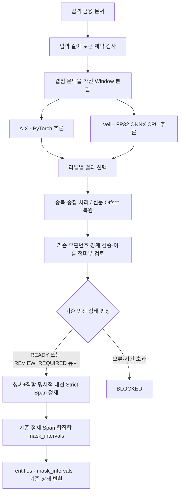

# Step 1 — Hybrid PII Detector

**A.X + Veil 기반 한국어 금융 문서 개인정보 탐지 모듈**

금융 문서에서 개인정보 구간(Span)과 유형을 식별하고, 라벨별 탐지 모델을 결합한 뒤 경계 오류 및 추론 실패를 보수적으로 처리하는 **재사용 가능한 Python 패키지**입니다.

> **현재 단계:** 최종 탐지 로직 확정 · 재사용 가능한 패키지 및 회귀 검증 구성\
> **범위:** PII 탐지·Span 검증·안전 상태 판정 (HMAC 가명 토큰 생성은 Step 2 담당)\
> [← AegisRAG 전체 프로젝트](../README.md)

## 1. Task & Data

**입력:** 금융 문서 텍스트\
**출력:** strict 개체 목록(`entities`), 보수적 마스킹 범위(`mask_intervals`), 처리 상태(`status`), 검토 이슈(`issues`)

탐지 대상 라벨은 다음 **7종**입니다.

| 라벨 | 예시 |
|---|---|
| `person` | 홍길동 |
| `phone_number` | 010-1234-5678 |
| `email` | user@example.com |
| `address` | 서울특별시 강남구 … |
| `resident_registration_number` | 합성 주민등록번호 |
| `account_number` | 합성 계좌번호 |
| `card_number` | 합성 카드번호 |

평가는 합성 금융 문서의 **Official Test 200건**, **Official Holdout 187건**, 별도 Generated 검증 데이터 등으로 수행했습니다. 본 모듈은 상위 과제에서 언급된 8종 후보 중 `organization`을 포함하지 않는 **7라벨 구현**입니다.

## 2. Final Architecture



### 2.1. Dual-Encoder & Label-wise Routing

두 토큰 분류 Encoder를 금융 개인정보 데이터에 맞춰 별도로 파인튜닝한 후 **고정된 라벨 담당 정책**으로 결합합니다.

| 담당 모델 | 처리 라벨 | 추론 경로 |
|---|---|---|
| **A.X** | `person`, `phone_number`, `email`, `resident_registration_number`, `account_number`, `card_number` | PyTorch · 가능한 환경에서는 GPU |
| **Veil** | `address` | FP32 ONNX Runtime · CPU, 공식 제약 디코더 |

- 두 모델이 산출한 Span을 Python 문자열 기준 **반열린 구간 `[start, end)`**으로 통일합니다.
- 담당 라벨에 해당하지 않는 예측은 결합 과정에서 제외하고, 중복·중첩 후보를 정리합니다.
- Hugging Face 모델은 `model_manifest.json`에 명시된 **고정 revision**을 사용합니다. 모델 가중치는 GitHub에 저장하지 않습니다.

### 2.2. Boundary Validation & Long Documents

- **우편번호 검증:** 주소 앞의 `(05299)` 같은 5자리 우편번호는 주변 문맥과 충돌 여부가 확인될 때에만 주소 Span에 포함합니다. 맥락이 불충분한 5자리 수나 후행 우편번호는 자동 확장하지 않고 검토 대상으로 표시합니다.
- **이름 경계 검토:** `이슬`과 `이슬이`처럼 접미부인지 이름의 일부인지 불확실한 경우 원본 Span을 임의로 자르지 않고 `REVIEW_REQUIRED`로 처리합니다.
- **긴 문서 처리:** 겹침 문맥 Window를 사용해 분할하고, 각 Window의 상대 Offset을 원문 위치로 복원합니다. 지정된 입력 길이·Window 상한을 초과하면 조용히 잘라내지 않고 차단합니다.

### 2.3. Reliability & Fail-closed

| 상태 | 의미 | 후속 처리 원칙 |
|---|---|---|
| `READY_FOR_PSEUDONYMIZATION` | 탐지 단계를 정상적으로 처리 | **Step 2 가명처리 필요**. 외부 전송을 의미하지 않음 |
| `REVIEW_REQUIRED` | 경계·중첩 등 검토 필요 | 검토·재처리 전 외부 전송 금지 |
| `BLOCKED` | 모델 오류, 시간 초과, 길이/토큰 제약 등 | 처리 중지 및 안전한 오류 반환 |

요청 단위 Lock으로 공유 백엔드의 동시 재진입을 방지하고, 한 요청 내부에서는 A.X/Veil을 병렬 실행합니다. 내부 진단 로그는 원문 PII를 포함하지 않도록 설계했습니다.

### 2.4. Minimal Structural Policy & Mask Contract

기존 조건부 우편번호 보정과 이름 접미부 검토 뒤에 **두 개의 Strict Span 억제 규칙만** 적용합니다.

1. `standalone_surname_title`: 공백 뒤에 직함이 붙은 한 글자 성씨만 PERSON `entities`에서 제외합니다. 완전한 이름, `김과장`처럼 공백 없는 문자열, 개행을 건너는 직함은 제외하지 않습니다.
2. `explicit_internal_extension`: `내선:` 또는 `내선번호:`로 명시된 2~6자리 숫자만 PHONE `entities`에서 제외합니다. 일반 전화, 대표번호, 고객센터 번호, 하이픈 포함 내선 표기는 제외하지 않습니다.

이 규칙은 기존 모델 예측·주소 검증·상태·issues를 바꾸지 않습니다. 정제된 `entities`는 Strict 평가용입니다. 실제 비식별화는 반드시 `mask_intervals`를 입력으로 사용해야 합니다. `mask_intervals`는 정제 전후 구간의 합집합이라 Strict `entities`에서 제외한 오탐 구간도 마스킹 범위로 유지합니다.

```python
result = detector.detect(text)
if result["status"] == "READY_FOR_PSEUDONYMIZATION":
    pseudonymize(text, result["mask_intervals"])
```

`REVIEW_REQUIRED`는 기존 review 경로로 보내고 `BLOCKED`는 후속 처리하지 않습니다. `mask_intervals`는 `{"start": int, "end": int}` 목록이며 원문 문자열이나 PII 값을 포함하지 않습니다. 정책 이벤트는 규칙명과 offset만 담습니다. 정책 오류는 기존 fail-closed 경로에서 `BLOCKED`가 됩니다.

## 3. Experiments & Results

처음 사용한 **팀 RoBERTa 탐지기**를 기준선(Baseline)으로 삼고, 최종적으로 **A.X + Veil 라벨별 Hybrid**를 채택했습니다. 아래 수치는 모두 **Strict F1**(라벨·시작·끝 위치 완전 일치) 및 **Mask Recall**(정답 개인정보 중 예측 구간이 덮은 문자 비율) 기준입니다.

### 3.1. 초기 RoBERTa vs 최종 Hybrid

| 평가셋 | 지표 | 초기 팀 RoBERTa | 최종 A.X + Veil Hybrid | 변화 |
|---|---|---:|---:|---:|
| **Generated Validation (195문서)** | **Strict F1** | 71.35% | **96.74%** | **+25.39%p** |
| | **Mask Recall** | 95.74% | **99.46%** | **+3.72%p** |
| **Official Test (200문서)** | **Strict F1** | **99.57%** | 99.23% | −0.34%p |
| | **Mask Recall** | **100.00%** | 99.97% | −0.03%p |

**해석:** 초기 RoBERTa는 Official Test에서 이미 높은 점수를 기록했지만, 별도 생성 검증셋에서는 Strict F1이 크게 낮았습니다. 최종 Hybrid는 생성 검증셋의 경계·라벨 일치율을 큰 폭으로 높였습니다. 반면 Official Test에서는 초기 RoBERTa가 소폭 더 높았습니다. 따라서 **모든 평가셋에서 최종 모델이 우수했다고 주장하지 않습니다.**

> 위 비교는 **프로젝트 초기 시스템과 최종 시스템의 성능 변화**입니다. 학습 데이터 구성과 모델 구조가 동일하게 통제된 단일 요인 Ablation은 아니므로, 개선 폭을 오직 Hybrid 결합만의 효과로 해석하지 않습니다. Generated Validation은 모델 선정 과정에서 사용된 개발성 검증셋으로, 독립 블라인드 평가가 아닙니다. 초기 RoBERTa 지표는 팀 내 기존 측정 기록에 기반하며, 해당 모델 체크포인트와 전체 원시 평가 로그는 현재 GitHub 저장소에 포함되어 있지 않습니다.

### 3.2. 최종 Hybrid의 평가셋별 결과

| 데이터셋 | 문서 수 | Strict Precision | Strict Recall | Strict F1 | Mask Recall | 완전 보호 문서 |
|---|---:|---:|---:|---:|---:|---:|
| **Official Test** | 200 | 98.81% | 99.66% | **99.23%** | **99.97%** | 197/200 |
| **Official Holdout** | 187 | 96.28% | 99.23% | **97.73%** | **99.48%** | 182/187 |

이 표는 **우편번호 경계 보정 이전에 설정을 동결한 Hybrid 탐지기**의 동일 공식 채점기 측정값입니다. 모델을 개발하면서 확인한 평가 데이터의 성격과, 처음 보는 데이터에서의 일반화 성능은 구분합니다.

### 3.3. 최종 경계 보정 효과 — 동일 Holdout 187문서

| 지표 | 최종 Hybrid (기본) | 최종 Hybrid + 조건부 우편번호 보정 | 변화 |
|---|---:|---:|---:|
| **Strict F1** | 97.73% | **98.27%** | **+0.54%p** |
| **Mask Recall** | 99.48% | **100.00%** | **+0.52%p** |
| **완전 보호 문서** | 182/187 | **187/187** | **+5문서** |

**중요한 평가 조건:** 우편번호 경계 보정은 **Holdout 오류를 확인한 이후 작성**했습니다. 따라서 보정 후 수치는 이미 확인한 Holdout에 대한 **사후 개선 결과**이며, 독립 블라인드 평가 결과가 아닙니다. Official Test에서는 보정 적용 사례가 없어 동결된 Hybrid 점수와 동일했습니다. 완전 보호 문서 수는 해당 평가셋의 정답 개인정보 문자를 모두 덮은 문서 수를 의미하며, 실제 운영 환경의 유출 위험 0%를 보장하지 않습니다.

### 3.4. 오류 분석 및 운영 안정성 개선

| 관찰한 문제 | 최종 설계에 반영한 내용 |
|---|---|
| 주소 앞 우편번호의 Span 누락 | 주소·우편번호 문맥과 인접 구간 충돌을 확인한 후 조건부 확장 |
| 이름 끝 음절과 조사/접미부의 불확실한 경계 | 자동 삭제·확장 대신 `REVIEW_REQUIRED` 표시 |
| 긴 문서 분할 시 문자 위치 손실 가능성 | 문맥 중첩 Window와 전역 Offset 복원 검증 |
| 동시에 요청한 탐지 작업에서 공유 백엔드 충돌 | 요청 단위 Lock, 요청 내부 A.X/Veil 병렬 실행 |
| 모델 오류·타임아웃 발생 시 부분 출력 사용 위험 | `BLOCKED`와 안전한 오류 코드 반환(Fail-closed) |

### 3.5. 최종 패키지 검증 범위

- 기존 회귀 18개에 신규 정책·마스크 계약·오프라인 채점기 검사를 더해 현재 작업공간에서 **오프라인 테스트 30개 통과**했습니다. 외부 기준 노트북이 없는 clone에서는 합성 parity 1개가 skip됩니다.
- 보관한 원본 탐지기와 합성 입력에서 `status`, `issues`, 허용된 `entities` 변경, 우편번호 결과 및 mask union을 비교했습니다. 이것은 실제 모델 추론 parity가 아닙니다.
- 이번 정책 브랜치의 실제 AX/Veil 추론과 Official Test/Holdout 재채점은 아직 수행하지 않았습니다. 기존 점수는 이전 동결 버전 수치이며, 신규 두 규칙의 결합 점수로 인용하지 않습니다.
- 신규 정책과 기존 우편번호 보정을 함께 적용한 Official Test/Holdout 결과는 아래 평가 스크립트로 **저장된 기존 05 예측 파일을 제공한 경우에만** 재현할 수 있습니다. 현재 GitHub에는 해당 예측 파일이 없으며, 이 브랜치의 성능 향상이나 Holdout 99%를 주장하지 않습니다.
- Python wheel 구성과 모델 Manifest 포함 여부를 점검했습니다. **팀원별 Private HF 권한, 설치 환경의 호환성, CPU-only 지연시간**은 해당 실행 환경에서 추가 확인이 필요합니다.

## 4. Package Structure

```text
step1_pii_detector/
├── README.md
├── pyproject.toml                  # Python 3.10~3.12 및 의존성 정의
├── .env.example                    # HF_TOKEN 예시 (비밀값 없음)
├── src/pii_detector/
│   ├── __init__.py                 # 공개 API
│   ├── detector.py                 # 최종 탐지 · 결합 · Window · 상태 판정
│   ├── structural_policy.py        # 두 개의 Strict Span 규칙과 보수적 mask union
│   ├── factory.py                  # create_detector() 및 환경 로드
│   ├── loader.py                   # 고정 HF revision 다운로드
│   ├── backends.py                 # A.X Torch / Veil ONNX 추론
│   └── model_manifest.json         # 모델 주소 · revision · 라벨 라우팅
├── tests/
│   ├── test_detector_boundaries.py # Span 및 우편번호 경계
│   ├── test_detector_runtime.py    # 타임아웃 · 요청 직렬화 · 안전 로그
│   ├── test_structural_policy.py   # 성씨·직함 · 내선 · mask 보존 반례
│   ├── test_offline_regression.py  # 저장 예측 채점 요약 검사
│   └── test_detector_reference_parity.py # 보관된 원본 대비 합성 회귀
└── evaluation/
    ├── run_compare.py             # Strict / Partial / Mask Recall 평가
    └── offline_regression.py      # 저장 예측에 기존 우편번호·정책 재적용
```

모든 Colab 실험 노트북·원시 데이터·중간 예측값을 배포 패키지에 포함하지는 않습니다. 실험 재현 자료는 개인정보·토큰·모델 접근권한을 검사한 후 별도 문서 또는 결과 요약으로 관리합니다.

## 5. Installation & Usage

**요구 환경:** Python `>=3.10,<3.13`, PyTorch, Transformers, ONNX Runtime. Private Hugging Face 모델 **2개**의 읽기 권한이 필요합니다.

```bash
cd step1_pii_detector
python -m pip install -e .
cp .env.example .env
# .env의 HF_TOKEN 값을 개인별 읽기 토큰으로 설정 (커밋 금지)
```

```python
from pii_detector import create_detector

detector = create_detector()  # 최초 실행 시 고정 revision 로딩 및 ONNX 준비
try:
    result = detector.detect("고객명: 홍길동, 연락처: 010-1234-5678")
    print(result["status"])
    print(result["entities"])  # [{"label": ..., "start": ..., "end": ...}, ...]
    print(result.get("mask_intervals", []))  # Step 2 비식별화 입력
    print(result["issues"])
finally:
    detector.close()
```

첫 실행은 모델 다운로드와 Veil ONNX 준비가 필요합니다. 이후에는 같은 Detector 인스턴스를 재사용합니다. 모델 가중치와 HF 토큰은 GitHub에 포함되지 않습니다.

### Tests

```bash
python -m unittest discover -s tests -v
```

보관된 기준 노트북을 포함한 개발 환경에서는 합성 입력의 baseline parity도 실행됩니다. GitHub 패키지에서 노트북이 없어 해당 테스트가 skip될 수 있습니다. 이 테스트는 실제 모델 추론 비교가 아닙니다.

공식 데이터 점수는 원본 05 저장 예측을 주고 명시적으로 실행합니다. Gold/예측 파일은 Git에 추가하지 마세요.

```bash
python -m evaluation.offline_regression \
  --dataset official_test \
  --gold /absolute/path/pii_synth_finance_test.jsonl \
  --pred /absolute/path/official_test_labelwise.jsonl \
  --include-existing-postal \
  --report /absolute/path/official_test_policy_summary.json

python -m evaluation.offline_regression \
  --dataset official_holdout \
  --gold /absolute/path/holdout_labeled.jsonl \
  --pred /absolute/path/official_holdout_labelwise.jsonl \
  --include-existing-postal \
  --report /absolute/path/official_holdout_policy_summary.json
```

보고서는 Strict P/R/F1, TP/FP/FN, 라벨별 오류 수, 실제 보수적 마스크의 미가림 문자, 정책 변경 수와 **모델 추론을 제외한 후처리 p50/p95**를 기록합니다. 기존 예측에 detector status가 저장되지 않은 경우 review 비율은 측정 불가로 표시합니다. Holdout은 기존 오류를 확인한 사후 자료이므로 개선값이 나와도 독립 일반화 성능으로 표현하지 않습니다.

## 6. Limitations & Next Steps

- **탐지율 100%를 보장하지 않습니다.** 상태가 `READY_FOR_PSEUDONYMIZATION`이라도 가명처리 전 원문을 외부로 전송해서는 안 됩니다.
- `REVIEW_REQUIRED`나 `BLOCKED` 결과는 Step 2에 무조건 전달하지 말고 안전한 재처리·차단 경로로 분기해야 합니다.
- Holdout 우편번호 개선값은 사후 분석 기반이며, **독립 블라인드 검증은 추가로 필요**합니다.
- 과제 운영 조건에 명시된 **CPU-only 성능**은 혼합 GPU/CPU 검증과 구분해 측정해야 합니다.
- 다음 단계는 **탐지 Span → 정규화 → 결정적 토큰 → Vault 분리 → 가명 문서 검색**으로 이어지는 Step 2 연계입니다.

---

**Step 1의 목표는 높은 F1 자체만이 아니라, 다음 단계에서 안전하게 소비할 수 있는 개인정보 Span과 명시적인 실패·검토 상태를 제공하는 것입니다.**
