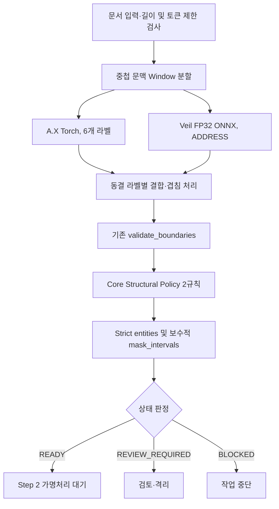

# Step 1 — Hybrid PII Detector

**A.X + Veil 기반 한국어 금융 문서 개인정보 탐지 패키지**

7개 개인정보 라벨에 대해 모델의 원본 문자열 구간(`[start, end)`)을 추출하고, 라벨별 라우팅·주소 경계 검증·실패 차단을 수행합니다. 추가 학습이나 모델 수 증가 없이 **범용 구조 후처리 두 개**를 적용하는 Core Structural Policy가 현재 `main` 브랜치의 detector API에 통합됐습니다. 오프라인 회귀와 mock 마스킹 검사는 통과했으며, 실제 모델 재추론은 수행하지 않았습니다.

> **현재 문서가 설명하는 `main` 브랜치 (2026-11-02):** 기존 2-Encoder 동결 탐지기·주소 보정에 `structural_policy.py`, `mask_intervals` 응답 및 회귀 테스트가 통합됐습니다. 실제 모델 추론 기반 Official 평가와 Step 2 end-to-end 연동은 미검증입니다.<br>
> **범위:** 탐지, 경계·상태 검증, 후속 가명처리용 보호 구간 API. HMAC 토큰 생성·Vault·RAG는 Step 2 담당.<br>
> [← 전체 프로젝트 README](../README.md)

## 1. Task와 라벨 정의

**입력:** 합성 금융 문서의 원문 텍스트<br>
**출력:** `status`, Strict `entities` (`label`, `start`, `end`), 보수적 `mask_intervals` (`start`, `end`), `issues`, `policy_version`, `structural_policy_events`, 실행 메타데이터

| Label | 의미 | 담당 모델 |
|---|---|---|
| `person` | 완전한 개인 이름 | A.X |
| `phone_number` | 정답 정책에 따라 포함되는 전화번호 | A.X |
| `email` | 이메일 주소 | A.X |
| `address` | 주소 및 정답 정책상 포함되는 우편번호 경계 | Veil |
| `resident_registration_number` | 주민등록번호 | A.X |
| `account_number` | 계좌번호 | A.X |
| `card_number` | 카드번호 | A.X |

조직명(`organization`)은 현재 구현의 평가 대상 7개 라벨에 포함되지 않습니다. 회사·대표번호·사내 내선과 같은 정보가 법적·업무상 민감하지 않다는 의미가 아니라 **해당 평가의 라벨 기준과 자동 Span 처리 범위를 구분**한다는 뜻입니다.

## 2. 아키텍처



### 2.1. 고정 모델 및 결합

- A.X는 PyTorch, Veil은 FP32 ONNX Runtime(공식 BIOES 제약 디코더)으로 추론합니다.
- 모델 주소·리비전은 `src/pii_detector/model_manifest.json`에 고정합니다. 비공개 가중치는 저장소에 없습니다.
- 기존 `fuse_labelwise()`는 A.X의 6개 라벨과 Veil의 ADDRESS를 선택하며, 겹치는 후보는 중복 처리합니다.
- Window별 오프셋을 원문 기준으로 복원합니다. 입력/Window/토큰 제한·모델 오류·타임아웃 시 `BLOCKED` 처리합니다.
- Core Policy로 인해 두 모델을 추가 실행하거나 다시 파인튜닝하지 않습니다.

### 2.2. 이미 구현된 조건부 경계 검증 — 그대로 유지

현행 `detector.py`의 `validate_boundaries()`는 주소 시작 부분의 괄호형 5자리 우편번호 및 필드 단서가 있는 비괄호형 우편번호를 **주소 형태·음성 필드 단서·다른 Span과의 중첩을 검사**한 뒤 선택적으로 포함합니다. 후행 5자리 숫자나 이름 마지막 `이`가 모호한 경우에는 무조건 경계를 변경하지 않고 검토 이슈로 남깁니다.

**주의:** V9에서 사용했던 단순한 `\(\d{5}\)` 주소 확장 규칙으로 이 코드를 교체하거나 이중 적용하지 않습니다. 실제 `validate_boundaries()`의 조건은 현재 GitHub 코드를 기준으로 유지해야 합니다.

### 2.3. Core Structural Policy — 통합된 두 규칙

다음 두 정책은 Gold 정답값이나 문서 ID를 조회하지 않고 일반적인 필드/표현 구조만 검사합니다.

| Rule | 인식 조건 | Strict `entities` 처리 | 안전성 제약 |
|---|---|---|---|
| `standalone_surname_title` | 한 글자 단독 성씨 뒤에 공백+직함·호칭이 오는 경우 | 완전한 PERSON으로 간주한 후보만 제거 | 3~4글자 실명·공백 없는 직함·개행을 가로지르는 패턴은 일괄 제외하지 않음 |
| `explicit_internal_extension` | `내선:`/`내선번호:`로 명시된 **2~6자리 짧은 숫자** | PHONE 후보에서 제외 | 대표번호·고객센터·하이픈 전화번호·긴 휴대전화는 제외하지 않음 |

원문이 추가로 노출되지 않게, 제거된 Strict 후보도 **`mask_intervals`에서는 계속 보호**합니다. 이 두 규칙의 선택은 이미 본 Holdout 오류 유형을 참고했으므로 Holdout 개선 점수는 독립 블라인드 일반화 성능이 아닙니다.

**기본 적용 제외:** V9의 경조사/친족 역할어 제거, 이름 마지막 `이` 절단, 시설명 기반 주소 제외, 단순 우편번호 주소 확장. 새로운 데이터에서 의미가 바뀔 수 있거나 기존 보수적 경계 검증과 충돌할 위험이 있습니다.

### 2.4. 상태 및 Step 2 계약

| 상태 | 의미 | 요구 사항 |
|---|---|---|
| `READY_FOR_PSEUDONYMIZATION` | 탐지 단계 정상 종료 | 아직 외부 전송 금지. Step 2에서 가명처리·검증 필요 |
| `REVIEW_REQUIRED` | 경계/충돌/검토 이슈 | 해결 전 외부 전송 금지 |
| `BLOCKED` | 잘못된 입력, 오류, 제한 초과 등 | 처리 중지, 원문·예외 메시지 노출 금지 |

현재 `main` 브랜치의 출력 계약:

```python
{
    "status": "READY_FOR_PSEUDONYMIZATION",
    "entities": [{"label": "person", "start": 4, "end": 7}],
    "mask_intervals": [{"start": 4, "end": 7}],
    "issues": [],
    "policy_version": "aegis_core_v1",
    "structural_policy_events": [],
}
```

`entities`는 정확한 라벨·Span 평가와 구조화 처리를 위한 값입니다. `mask_intervals`는 **기존 `validate_boundaries()`를 거친 기준 구간과 정책 적용 후 구간의 합집합으로 관리하는 보수적 보호 범위**입니다. 이 둘은 같지 않을 수 있습니다. 정책으로 FP가 제거되더라도 실제 과잉 마스킹은 그대로 남을 수 있습니다.

**Step 2는 반드시 `mask_intervals`를 사용**해야 합니다. 실제 Step 2 호출부는 아직 구현되지 않았으며, mock pseudonymizer 테스트만으로 실제 통합이 검증된 것은 아닙니다. 필드 누락·검증 오류·`REVIEW_REQUIRED`·`BLOCKED`에서는 원문 외부 전송을 차단해야 합니다. 마스킹된 구간의 라벨/치환 값 매핑은 별도의 정합성 검증이 필요합니다.

## 3. 평가 설계와 결과

### 3.1. 데이터 분리

| 데이터 | 규모 | 사용 방식 |
|---|---:|---|
| Official Test | 200문서, Gold 1,165개체 | 초기 동결 성능 및 회귀 확인 |
| Official Holdout | 187문서, Gold 912개체 | 최초 미확인 문서 성능 기록 후 오류 분석에 사용 |
| Generated Validation | 195문서, Gold 502개체(원본 기준) | 개발/추가 오류 진단. 일부 합성 주석 일관성 검토 필요 |

Official Holdout은 **이미 오류를 분석했기 때문에 더 이상 완전 블라인드 평가셋이 아닙니다**. 제공된 Official Gold를 임의로 고쳐 점수를 높이지 않으며, Generated 데이터의 주석 오류 의심 사례도 근거 없이 평가에서 제외하지 않습니다.

### 3.2. 최초 동결 기준선

| 데이터 | TP | FP | FN | Strict F1 | Mask Recall |
|---|---:|---:|---:|---:|---:|
| Official Test | 1,161 | 14 | 4 | **99.2308%** | **99.9678%** |
| Official Holdout | 905 | 35 | 7 | **97.7322%** | **99.4766%** |

### 3.3. 저장된 05 예측의 오프라인 재채점

| 처리 단계 / 평가 | Strict F1 | Mask Recall | TP / FP / FN | 해석 |
|---|---:|---:|---|---|
| 최초 동결 예측 · Test | 99.2308% | 99.9678% | 1,161 / 14 / 4 | 05 저장 예측 기준선 |
| 최초 동결 예측 · Holdout | 97.7322% | 99.4766% | 905 / 35 / 7 | 첫 확인 당시 결과; 이후 오류 분석을 수행 |
| 신규 두 규칙만 · Test | 99.3582% | 99.9678% | 1,161 / 11 / 4 | 저장 예측에 정책만 오프라인 적용 |
| 신규 두 규칙만 · Holdout | 98.7991% | 99.4766% | 905 / 15 / 7 | 주소 검증 미적용, 사후 분석 |
| 현재 저장소 주소 검증 + 신규 정책 · Test | 99.3582% | 99.9678% | 1,161 / 11 / 4 | 저장 예측 후처리; 실모델 `detect()` 재실행 아님 |
| 현재 저장소 주소 검증 + 신규 정책 · Holdout | 99.3450% | 100.0000% | 910 / 10 / 2 | 저장 예측 후처리; 실모델 `detect()` 재실행 아님, 사후 분석 |

이 재채점은 저장된 05 예측에 현행 `validate_boundaries()`와 정책 후처리를 실행한 결과입니다. 모델 backend를 다시 실행하지 않았으므로 **통합된 API의 실모델 성능 또는 최종 배포 점수로 해석하지 않습니다.** 두 규칙은 Test에서 FP 3개, Holdout에서 FP 20개를 Strict `entities`에서 제외했고, 이번 저장 예측 비교에서는 TP 제거가 없었습니다. Holdout은 이미 오류 분석에 사용한 사후 자료입니다.

기존 초기 팀 RoBERTa 비교 기록(Official Test F1 **99.57%** vs Hybrid **99.23%**; Generated F1 **71.35%** vs Hybrid **96.74%**)은 모델 구조와 학습 데이터가 동일한 일요인 실험이 아닙니다. 특정 데이터셋에서 Hybrid가 항상 우수했다고 해석하지 않습니다.

### 3.4. 검증 상태와 남은 확인 사항

- Core Policy 두 규칙과 응답 `entities`, `mask_intervals`, `policy_version`, `structural_policy_events`가 `main` 브랜치에 구현됐습니다.
- 기본·경계·정책·mock 마스킹·오프라인 평가 테스트 **29개 통과, 외부 기준 노트북 parity 1개 skip**. Wheel 빌드와 모델 Manifest 포함을 확인했습니다.
- 모델 재추론, 실제 HF 접근, CPU-only 성능, 실제 Step 2 호출부 연동은 수행하지 않았습니다. Official 재채점은 저장된 05 예측에 대한 오프라인 후처리로 제한됩니다.
- 실모델 동일 revision 스모크 테스트와 통합 detector API 기반 Test/Holdout 평가는 아직 필요합니다. 따라서 신규 결과를 최종 배포 점수로 주장하지 않습니다.

## 4. 코드 구조

```text
step1_pii_detector/
├── README.md
├── STRUCTURAL_POLICY_VALIDATION.md
├── .gitignore
├── pyproject.toml
├── .env.example
├── src/pii_detector/
│   ├── __init__.py
│   ├── detector.py              # 동결 결합, 기존 경계, 상태·런타임 제어
│   ├── backends.py              # A.X PyTorch, Veil ONNX
│   ├── factory.py               # create_detector()
│   ├── loader.py                # Private HF revision 다운로드
│   ├── model_manifest.json      # 고정 모델/라벨 및 코드 해시
│   └── structural_policy.py     # 두 구조 규칙과 mask interval union
├── tests/
│   ├── test_detector_boundaries.py
│   ├── test_detector_runtime.py
│   ├── test_detector_reference_parity.py
│   ├── test_structural_policy.py
│   └── test_offline_regression.py
└── evaluation/
    ├── run_compare.py
    └── offline_regression.py
```

`model_manifest.json`에는 동결 원본 해시(`baseline_detector_module_sha256`), 현재 detector 코드 해시, 정책 모듈 해시, 정책 버전이 구분되어 기록됩니다. A.X/Veil 모델 revision은 변경하지 않았습니다.

## 5. 설치 및 실행

**요구 환경:** Python `>=3.10,<3.13`, PyTorch, Transformers, ONNX Runtime. Private Hugging Face 모델 2개에 대한 읽기 권한이 필요합니다.

```bash
cd step1_pii_detector
python -m pip install -e .
# HF_TOKEN은 환경변수 또는 Git에서 제외된 .env에 보관
python -m unittest discover -s tests -v
```

```python
from pii_detector import create_detector

with create_detector() as detector:
    result = detector.detect("성명: 홍길동, 연락처: 010-1234-5678")
    print(result["status"])
    print(result["entities"])
    print(result["mask_intervals"])  # Step 2 비식별화 입력
    print(result["issues"])
```

`create_detector()`는 private repo를 읽고 최초 실행 시 모델 다운로드/Veil ONNX 준비가 필요합니다. 단위 테스트 성공은 실모델 추론·Official 평가 성공과 같지 않습니다. CPU-only 지연시간은 별도 측정이 필요합니다.

Gold와 저장 예측 파일은 별도로 제공되는 로컬 평가 자료를 사용하고 Git에 커밋하지 않습니다. 저장된 05 예측을 다음 명령으로 재채점할 수 있으며, 이 명령은 모델 추론을 실행하지 않습니다.

```bash
python -m evaluation.offline_regression \
  --dataset official_test \
  --gold /path/to/official_test.jsonl \
  --pred /path/to/official_test_labelwise.jsonl \
  --include-existing-postal

python -m evaluation.offline_regression \
  --dataset official_holdout \
  --gold /path/to/official_holdout.jsonl \
  --pred /path/to/official_holdout_labelwise.jsonl \
  --include-existing-postal
```

이 도구는 집계 점수만 출력하며 원문·문서 ID를 보고서에 기록하지 않습니다. 저장 예측에 detector 상태가 없어 review 비율은 측정할 수 없습니다.

## 6. 릴리스 체크리스트와 Step 2 연결

- [x] 두 Core Policy 규칙의 detector 통합 및 신규 경계·정책 단위 테스트
- [x] `entities` / `mask_intervals` / `status` 계약과 mock 가명처리 검사
- [x] 오프라인 테스트 29개 통과, 외부 원본 노트북 parity 1개 skip; wheel에 정책과 Manifest 포함
- [ ] 고정 모델 revision 실모델 추론 및 통합 API 기준 Official Test/Holdout 평가
- [ ] CPU-only 전체 지연시간, 검토 비율, 실제 마스킹 과잉/누락 평가
- [ ] 실제 Step 2 코드에서 `mask_intervals` 기반 가명처리 및 외부 전송 차단 테스트
- [ ] 코드 SHA·모델 revision·평가 분할·사후 분석 여부 기록 후 최종 승인·태그

현재 구현/단위 검사 통과는 Step 1의 실모델 릴리스 검증이나 Step 2 통합 완료를 의미하지 않습니다. 실제 개인정보 원문을 외부 임베딩/LLM으로 전송하는 것은 별도의 안전성 검증 없이 허용하지 않습니다.

---

Step 1의 목표는 한 평가셋의 F1을 최대로 만드는 데 그치지 않고, **설명 가능한 판단 규칙, 안정적인 탐지 API, 후속 가명처리 단계의 보안 계약**을 제공하는 것입니다.
